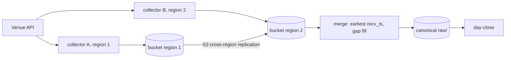

# Cloud sinks and replication

How recorded files leave the recorder's disk, and how recording is planned to survive the
loss of one collector or region.

## Current state

- `Market_recorder.Uploader` runs a configured command for each closed raw minute file,
  with `{file}` (absolute path) and `{rel}` (path relative to `data_dir`) substituted:

  ```lisp
  (upload ((command (rclone copyto {file} s3:bucket/prefix/{rel}))
           (delete_after_upload true)))
  ```

- Failed runs are retried with exponential backoff (1 s doubling to 5 min), at most 4
  commands run at once, and the queue is persisted in `<data_dir>/upload-pending.sexp`,
  so a restart re-uploads. With `delete_after_upload` the local volume is a buffer, not
  an archive.
- rclone covers S3, GCS, Azure Blob, Cloudflare R2, MinIO and other S3-compatible stores
  with one binary and one config, so no store-specific code exists in OCaml. The Helm
  chart configures an rclone remote named `s3` entirely from environment variables
  (`RCLONE_CONFIG_S3_*`, instance-role credentials by default) and renders the upload
  command into the recorder's ConfigMap. The service image adds rclone through its
  `RUNTIME_PACKAGES` build argument.
- Only raw minute files go through the uploader. The day-close CronJob uploads
  `parquet/` with `rclone copy`; `norm/` event logs are not uploaded.
- Decision record: [ADR 0005](../adr/0005-command-based-uploader.md).

## When a native sink is justified

The command uploader spawns one process per file. That stays cheap at the current scale
(a few venues times a few symbols times four streams is tens of files per minute). A
native sink in OCaml (an S3 client over `venue-net`'s HTTP, or an Async binding) becomes
worth its code when one of these holds:

- **File rate**: hundreds of symbols make thousands of process spawns per minute, or
  per-process startup (credentials, TLS) dominates the upload time.
- **Diskless streaming**: recording must stream multipart uploads without a local
  volume (for example on spot nodes with tiny disks).
- **Conditional writes**: replication needs `If-None-Match` or checksum-verified puts to
  make concurrent collectors safe without a listing step.
- **Observability**: per-request latency, bytes and error classes are needed in the
  recorder's `/metrics` instead of a command's exit status.

Until then the command interface is the sink API: a native sink would implement the same
"closed file in, success or retry out" contract behind the same queue.

## Replication design (planned)

Goal: no gap in the system of record when one collector, node or region fails, and no
manual merge.



- **Immutable minute files.** A closed minute file is never rewritten, so replication is
  copy-only and conflict-free. Each collector adds its id to the key (for example
  `<HH>-<MM>.<collector>.ndjson.zst`), so two collectors never write the same object.
- **Two collectors per exchange in two regions**, each a full recorder with its own
  volume and uploader, both connected to the venue for the same symbols and streams.
- **S3 cross-region replication** copies each regional bucket's `raw/` prefix into the
  other (or into one central bucket); the files being immutable and uniquely named, the
  rule needs no ordering.
- **Merge.** For each venue, stream, symbol and minute, a merge job reads both copies and
  writes one canonical file: messages are matched by their venue identity (trade id,
  book update id, or the frame text itself), each message keeps the copy with the
  earliest `recv_ts`, and a stretch one collector missed (empty-line disconnect, missing
  file) is filled from the other. The output uses the same line format, so every reader
  works on it unchanged.
- **Regeneration.** Day close is idempotent and keyed on file times, so after a merge
  rewrites a day's raw files the derived `norm/` and `parquet/` are rebuilt by running it
  again (`-force` where timestamps do not show the change).

## Open questions

- Message identity per stream: Binance `u` and Bybit `u`/`seq` sequence numbers, and
  Hyperliquid `l2Book` snapshots keyed by `time`; are these identical across two
  connections, or connection-scoped?
- Whether to merge raw files or only derived events (simpler identity, but the raw file
  stops being the merged record).
- Where the merge runs (a CronJob per region, or one in the central region) and how late
  it may run before day close.
- How the recorder should mark client reconnects (today they are invisible through
  `Market_data.Feed.t`, so only stops write a disconnect line).
- Uploading `norm/`, or always regenerating it from raw, which needs a raw-to-norm tool
  that does not exist yet.
- Cost: cross-region replication doubles storage and adds transfer fees; lifecycle rules
  could expire the non-canonical copies after merge.
