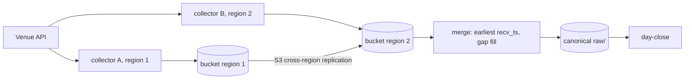

# Cloud sinks and replication

Kind: explanation.

How recorded files leave the recorder's disk, and how recording is planned to survive the
loss of one collector or region.

## Current state

- `Market_recorder.Uploader` runs a configured command for each closed raw minute file,
  with `{file}` (absolute path) and `{rel}` (path relative to `data_dir`) substituted:

  ```lisp
  (upload ((command (rclone copyto {file} s3:bucket/prefix/{rel}))
           (delete_after_upload true)))
  ```

- Failed runs are retried with exponential backoff (1 s doubling to 5 min), at most 4
  commands run at once, and the queue is persisted in `<data_dir>/upload-pending.sexp`,
  so a restart re-uploads. With `delete_after_upload` the local volume is a buffer, not
  an archive.
- rclone covers S3, GCS, Azure Blob, Cloudflare R2, MinIO and other S3-compatible stores
  with one binary and one config, so no store-specific code exists in OCaml. The Helm
  chart configures an rclone remote named `s3` entirely from environment variables
  (`RCLONE_CONFIG_S3_*`, instance-role credentials by default) and renders the upload
  command into the recorder's ConfigMap. The service image adds rclone through its
  `RUNTIME_PACKAGES` build argument.
- Only raw minute files go through the uploader. The day-close CronJob uploads
  `parquet/` with `rclone copy`; `norm/` event logs are not uploaded.
- Decision record: [ADR 0005](../adr/0005-command-based-uploader.md).

## When a native sink is justified

The command uploader spawns one process per file. That stays cheap at the current scale
(a few venues times a few symbols times four streams is tens of files per minute). A
native sink in OCaml (an S3 client over `venue-net`'s HTTP, or an Async binding) becomes
worth its code when one of these holds:

- **File rate**: hundreds of symbols make thousands of process spawns per minute, or
  per-process startup (credentials, TLS) dominates the upload time.
- **Diskless streaming**: recording must stream multipart uploads without a local
  volume (for example on spot nodes with tiny disks).
- **Conditional writes**: replication needs `If-None-Match` or checksum-verified puts to
  make concurrent collectors safe without a listing step.
- **Observability**: per-request latency, bytes and error classes are needed in the
  recorder's `/metrics` instead of a command's exit status.

Until then the command interface is the sink API: a native sink would implement the same
"closed file in, success or retry out" contract behind the same queue.

## Replication design (planned)

Status: the merge step is done as `market-recorder merge` (frame-text identity within a
window, earliest `recv_ts`, disconnect lines kept only where both copies have a gap, a
`_merge/<date>.json` report) with `scripts/replicate-day.sh` fetching two collectors'
days through rclone; see [market-recorder](../repos/market-recorder.md#replication).
Sequence-based identity and gap lists, suspected gaps from silence, the clock bound, the
L2 snapshot rule, collector ids in keys, and the deployment (second collector,
cross-region replication, merge job) are planned.

Goal: no gap in the system of record when one collector, node or region fails, and no
manual merge.



- **Immutable minute files.** A closed minute file is never rewritten, so replication is
  copy-only and conflict-free. Each collector adds its id to the key (for example
  `<HH>-<MM>.<collector>.ndjson.zst`), so two collectors never write the same object.
- **Two collectors per exchange in two regions**, each a full recorder with its own
  volume and uploader, both connected to the venue for the same symbols and streams.
- **S3 cross-region replication** copies each regional bucket's `raw/` prefix into the
  other (or into one central bucket); the files being immutable and uniquely named, the
  rule needs no ordering.
- **Merge.** For each venue, stream, symbol and minute, a merge job reads both copies and
  writes one canonical file: messages are matched by their venue identity (trade id,
  book update id, or the frame text itself), each message keeps the copy with the
  earliest `recv_ts`, and a stretch one collector missed (empty-line disconnect, missing
  file) is filled from the other. The output uses the same line format, so every reader
  works on it unchanged.
- **Regeneration.** Day close is idempotent and keyed on file times, so after a merge
  rewrites a day's raw files the derived `norm/` and `parquet/` are rebuilt by running it
  again (`-force` where timestamps do not show the change).

### Gap detection

A collector's copy of a stream has a gap when frames the venue sent never reached its file.
The merge finds gaps per venue, stream and symbol from the fields below, then fills them
from the peer. Only the fields marked "checked by" are read by our code today; the others
come from the venues' documentation and need a fixture before the merge relies on them.

| Venue | Stream | Sequence | Contiguous | Checked by |
| --- | --- | --- | --- | --- |
| Binance | `l2` (`@depth@100ms`) | `U`, `u`, `pu`: each event's `pu` equals the previous `u` | yes | `Binance_client.Local_book` |
| Binance | `trades` (`@aggTrade`) | aggregate trade id `a` | yes, per symbol | not checked |
| Binance | `bbo`, `funding` | none decoded (`E`, `T` times only) | no | not checked |
| Bybit | `l2` (`orderbook.<depth>`) | `u` +1 per delta; a snapshot (or `u = 1`) restarts it | yes, per topic | `Bybit_client.Local_book` |
| Bybit | `l2`, `trades`, `funding` | `seq` / cross sequence | no (increasing only) | not checked |
| Hyperliquid | `l2`, `bbo` | `l2Book` `time`; every message is a full book | no | not checked |
| Hyperliquid | `trades`, `funding` | trade `tid`; none for `activeAssetCtx` | no | not checked |

- **Contiguous sequences** give exact gaps: the merge lists the missing ids per minute,
  and a gap is filled when the peer's copy holds every missing id. The output records
  each unfilled range.
- **Increasing-only sequences and times** give suspected gaps: a silence longer than the
  stream's normal interval (Binance depth every 100 ms; for other streams measured from
  recorded days) where the peer has frames. These are filled by time range,
  bounded by the clock bound below.
- **Disconnect lines** (empty lines) and missing minute files mark the gap boundaries
  directly; reconnects inside the venue clients write nothing today, which is why the
  sequence checks above matter.
- **Snapshots.** After a fill, an L2 stream must still replay into a consistent book: a
  Binance or Bybit fill is accepted only if its first delta continues the last applied
  `u` of the other copy, otherwise the merge keeps both copies' frames up to the next
  snapshot from the copy that has one, and the gap is reported, not hidden.

### Clock bound

`recv_ts` of two collectors comes from two hosts' clocks, so "earliest `recv_ts`" is only
meaningful when the two stamps differ by more than both clocks' error. Each collector
reports its bound `e` (planned: a clock-error gauge sampled from `chronyc -c tracking`,
see [market-recorder](../repos/market-recorder.md)); for a pair of frames the bound is
`e_A + e_B`.

- Frames whose `recv_ts` differ by less than the bound are **unordered**: the merge orders
  them by venue sequence when there is one, else by `exch_ts`, else by collector id, so
  the output is deterministic and never claims an ordering the clocks cannot support.
- A collector whose bound is unknown or above a limit (planned: 10 ms) for a minute is
  used only to fill gaps in that minute, never to choose the earliest copy.
- Latency measurements (`recv_ts - exch_ts`) from merged files mix two hosts; per
  collector latency is read from that collector's unmerged copy.

### Failure table

| Failure | Expected gap | How readers detect it | Recovery |
| --- | --- | --- | --- |
| One collector process crashes | Seconds until restart on that collector; none after merge | Disconnect line or missing frames in that copy; peer copy complete | Restart; merge fills from the peer |
| One node or region down | Minutes to hours in that copy; none after merge | Missing minute files from that collector id | Merge fills from the peer; the down collector's files never arrive |
| Venue disconnects one collector | Reconnect time (backoff up to 30 s) in that copy | Sequence break (Binance `pu`, Bybit `u`), stream silence | Client resyncs from a snapshot; merge fills from the peer |
| Both collectors disconnected | Overlap of both outages | Sequence break or silence in both copies | None: the gap stays and is listed in the merge output |
| Uploader stalled (store down, credentials) | None if the volume holds; files arrive late | `upload-pending.sexp` length, uploader gauges on `/metrics` | Retries with backoff; the merge waits or runs again when files land |
| Volume full while uploads stall | From the full disk until space returns | `Raw_writer` flush errors; missing minute files | Peer copy fills; alert on the pending queue first |
| Cross-region replication lag | None; merge input is late | Object missing in the merge bucket, present in the source | Merge runs after a delay or re-runs; day close follows |
| Clock step on one host | None; ordering inside the bound is unreliable | Clock-error gauge, `recv_ts` going backwards | Treat that minute as fill-only (above) |
| Parse change in a client | None in raw; derived data wrong | Day-close diffs, parse-error counters (planned) | Rebuild `norm/` and Parquet from raw |

## Open questions

- Message identity per stream: Binance `u` and Bybit `u`/`seq` sequence numbers, and
  Hyperliquid `l2Book` snapshots keyed by `time`; are these identical across two
  connections, or connection-scoped?
- Whether to merge raw files or only derived events (simpler identity, but the raw file
  stops being the merged record).
- Where the merge runs (a CronJob per region, or one in the central region) and how late
  it may run before day close.
- How the recorder should mark client reconnects (today they are invisible through
  `Market_data.Feed.t`, so only stops write a disconnect line).
- Tagging events, not only file keys, with collector and region, so a merged `norm/` or
  Parquet row says which copy it came from and per-collector latency survives the merge.
- Whether Binance `@aggTrade` ids and Bybit `seq` are identical across two connections
  (assumed by the gap table above; to be checked on two recorded copies of one minute).
- Uploading `norm/`, or always regenerating it from raw, which needs a raw-to-norm tool
  that does not exist yet.
- Cost: cross-region replication doubles storage and adds transfer fees; lifecycle rules
  could expire the non-canonical copies after merge.
