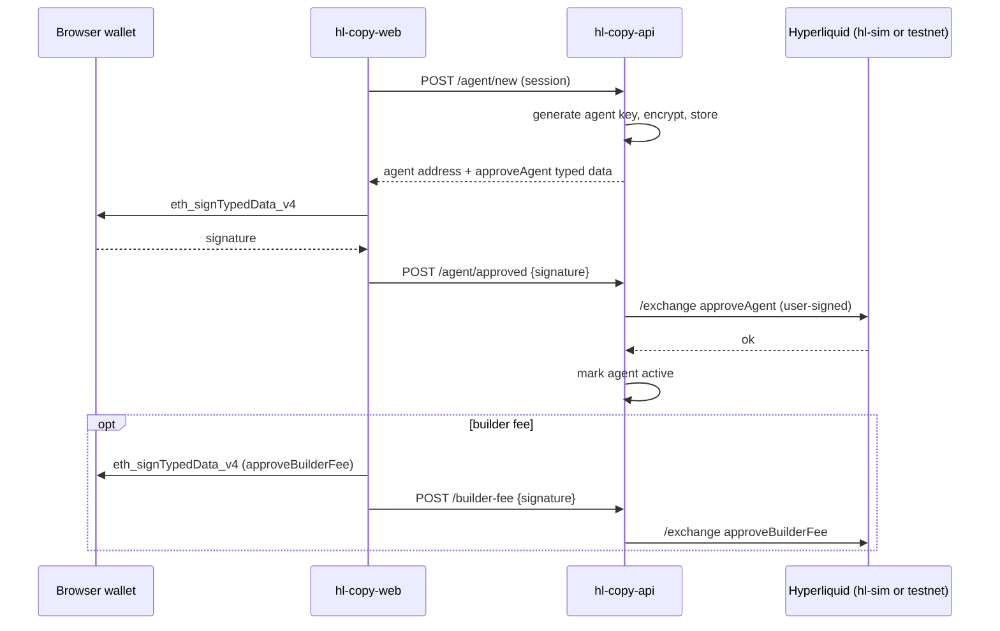
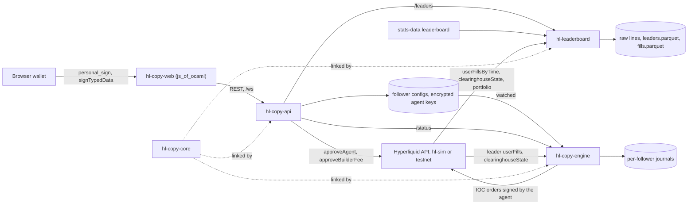

# Copy-trading platform

Kind: explanation.

Status: in progress. The five repositories ([hl-copy-core](../repos/hl-copy-core.md),
[hl-leaderboard](../repos/hl-leaderboard.md), [hl-copy-engine](../repos/hl-copy-engine.md),
[hl-copy-api](../repos/hl-copy-api.md), [hl-copy-web](../repos/hl-copy-web.md)) are being
built, together with copy-trading support in [hl-protocol](../repos/hl-protocol.md),
[hl-client](../repos/hl-client.md) and [hl-sim](../repos/hl-sim.md). Everything below is
the design; the repository pages say what has landed. [hl-copy-core](../repos/hl-copy-core.md)
is done: the scaling, caps, rounding, mirroring, scoring and pnl below are in code.

A user logs in with a browser wallet, approves an agent key the platform generated for
them (and optionally a builder fee), picks a leader trader from a ranked list, and the
platform mirrors the leader's position changes into the user's Hyperliquid account,
scaled to the user's capital and clamped by risk caps. The platform never holds the
user's wallet key ([ADR 0007](../adr/0007-agent-keys-not-custody.md)), and the frontend
is OCaml too ([ADR 0008](../adr/0008-bonsai-web-frontend.md)).

Hyperliquid facts on this page come from the public API documentation, linked inline
and listed under [Sources](#sources), as read on 2026-10-13. Statements marked
"(unverified)" were not found in the documentation and need a check against testnet
before code relies on them.

## Actors

| Actor | Holds | Can do |
| --- | --- | --- |
| User wallet | The user's own private key, in the browser wallet | Sign the login challenge, `approveAgent`, `approveBuilderFee`; deposit, withdraw, revoke |
| Agent key | A secp256k1 key the platform generates per follower, encrypted at rest | Sign orders and cancels for the user's account; nothing else the platform uses |
| Builder | A platform address with at least 100 USDC of perps account value | Receive the builder fee the user approved, charged per order |
| Leader | Any Hyperliquid address | Nothing; read only through public info and websocket data |

An agent ("API wallet") is "only used to sign": queries must name the master account,
not the agent address
([nonces and API wallets](https://hyperliquid.gitbook.io/hyperliquid-docs/for-developers/api/nonces-and-api-wallets)).
Whether an agent can withdraw is not stated on that page; the design assumes it cannot
move funds out of the account and does not depend on it either way (unverified).

## Login

Login is a wallet signature over a server challenge, with no password and no Hyperliquid
action involved.

1. `POST /auth/challenge {address}`: `hl-copy-api` returns a message containing the
   address, the API origin, a random single-use nonce, the issue time and an expiry
   (five minutes). The text follows the EIP-4361 ("Sign-In with Ethereum") layout so
   wallets display it readably.
2. The browser asks the wallet for `personal_sign` over that message (EIP-191,
   `"\x19Ethereum Signed Message:\n" ++ len ++ message`, then Keccak-256).
3. `POST /auth/verify {address, nonce, signature}`: the API recovers the signer with secp256k1
   public key recovery (the same Keccak and recovery code `hl-client` uses for its
   signer check), compares it to `address`, burns the nonce, and issues a session token:
   address, issue time and expiry, HMAC-signed with a server key. Every later request
   carries it; the API checks the HMAC and the expiry and never stores sessions.

The challenge nonces live in memory with a TTL, so a restart forces a new challenge,
which is harmless.

Status (2026-10-13): implemented in hl-copy-api (`Challenge`, `Session`,
`Wallet_signature`); the token is `<address>.<issued_ms>.<expires_ms>.<mac>`, keyed by a
key derived from the master key, and `personal_sign` signatures are pinned against
`eth_account` in its tests.

Status (2026-10-13): [hl-copy-web](../repos/hl-copy-web.md) implements the browser side
(`eth_requestAccounts`, `personal_sign` of the hex-encoded message, `/auth/verify`) and
defines the bodies in `Api_types.Auth`; the server side is in progress.

## Agent approval

`approveAgent` is a user-signed action, not an L1 action: the wallet signs EIP-712 typed
data with primary type `HyperliquidTransaction:ApproveAgent` and fields
`hyperliquidChain` (string), `agentAddress` (address), `agentName` (string), `nonce`
(uint64), under the domain `{name: "HyperliquidSignTransaction", version: "1", chainId,
verifyingContract: 0x0}`
([exchange endpoint](https://hyperliquid.gitbook.io/hyperliquid-docs/for-developers/api/exchange-endpoint);
the type list and domain are from the official Python SDK's
[`signing.py`](https://github.com/hyperliquid-dex/hyperliquid-python-sdk/blob/master/hyperliquid/utils/signing.py),
`sign_agent` and `user_signed_payload`). `chainId` is the chain the wallet signs on,
sent as `signatureChainId` in hex (the docs give `0xa4b1` for Arbitrum; the SDK sends
`0x66eee`); the environment is carried by `hyperliquidChain` (`"Mainnet"` or
`"Testnet"`), which is what stops a testnet approval from being replayed on mainnet. The
action's `nonce` is the current time in milliseconds and must equal the outer request's
nonce.

Design choices that follow from the documented agent rules:

- **Named agent.** "An account can have 1 unnamed approved wallet and up to 3 named
  ones", and approving a new unnamed agent deregisters the old one. The platform
  therefore approves a named agent (`agentName` = a fixed platform name), so a user's
  own unnamed API wallet keeps working. Approving again under the same name replaces
  the platform's agent, which is how key rotation works.
- **Expiry.** A name may end with `valid_until {timestamp}`, at most 180 days ahead
  (exchange endpoint page). The platform sets one and asks the user to re-approve
  before it passes; the engine pauses a follower whose agent has expired.
- **Never reuse an agent address.** After deregistration "its nonce state may be
  pruned", so old signed actions could replay; the docs suggest a new agent wallet each
  time. Rotation always generates a new key.
- **One agent per follower process.** Nonces are tracked per signer and the docs advise
  a separate API wallet per trading process. One follower runs in one place, so its
  agent's millisecond nonce counter never races.

`approveBuilderFee` is optional, signed the same way with primary type
`HyperliquidTransaction:ApproveBuilderFee` and fields `hyperliquidChain`, `maxFeeRate`
(percent string, for example `"0.001%"`), `builder`, `nonce`. It "must be signed by the
user's main wallet, not an agent", the fee is at most 0.1% on perps, and the builder
needs at least 100 USDC of perps account value
([builder codes](https://hyperliquid.gitbook.io/hyperliquid-docs/trading/builder-codes)).
Orders then carry `builder: {b: address, f: fee}` with `f` in tenths of a basis point,
and `maxBuilderFee {user, builder}` on the info endpoint returns the approved maximum
in the same unit
([info endpoint](https://hyperliquid.gitbook.io/hyperliquid-docs/for-developers/api/info-endpoint)).
The engine reads `maxBuilderFee` at follower start and sends no builder field (rather
than a rejected order) when the approval is missing or lower than the configured fee.
How a user revokes a builder approval is not described in the docs (unverified;
presumably a new approval with a lower rate).

Status (2026-10-13): the wire types are in hl-protocol (`User_signed_action`,
`User_signed_request`, `Builder_fee`, `Order_action`) and signing and sending in
hl-client (`Signing.sign_user_action` and `recover_user_action`,
`Exchange.approve_agent` and `approve_builder_fee`, the same on `Client` owner handles,
`place_orders ?builder`, and `Client.trading_with_agent` for orders signed by the agent).
The approval signatures match `eth_account` on the SDK's payload; nothing has been sent
to testnet yet. `maxBuilderFee` has no client call yet. hl-copy-api serves the flow above
against hl-sim with signature checks on: `/agent/new` offers the named agent
`hl-copy valid_until <ms>` (179 days) with its typed data, `/agent/approved` and
`/builder-fee` accept only the pending action (the browser may change
`signatureChainId`) signed by the session's wallet, and an unapproved offer is reused for
an hour instead of minting another key.
hl-sim (2026-10-13) verifies both approvals (EIP-712 recovery), maps agents to
accounts with the documented limits (one unnamed and three named agents, `valid_until`
expiry, per-signer nonces), accepts agent-signed orders for the account, checks and
charges builder codes on every fill, and answers `maxBuilderFee` and `extraAgents`;
hl-client's owner and agent handles pass against it with `-strict-signatures`.
In the browser, hl-copy-web builds the same typed data from `Api_types.Approve_agent` and
`Approve_builder_fee`, shows it in full before signing, replaces `signatureChainId` with
the wallet's `eth_chainId` (wallets refuse typed data for another chain), and posts the
action as signed to `/agent/approved` and `/builder-fee`. Following asks for a new
approval only when `GET /me` reports the agent missing, unapproved or past its
`valid_until`.

## Leader discovery and scoring

`hl-leaderboard` builds the ranked list offline, read only, without keys:

1. **Candidates.** `https://stats-data.hyperliquid.xyz/Mainnet/leaderboard` returns
   `{"leaderboardRows": [...]}` with, per row, `ethAddress`, `accountValue`,
   `displayName`, `prize` and `windowPerformances` for `day`, `week`, `month` and
   `allTime`, each `{pnl, roi, vlm}` as decimal strings. A pull on 2026-10-13 returned
   47,245 rows and 38.8 MB. This endpoint is the one the Hyperliquid web app uses and is
   not in the API documentation (unverified as a stable interface); the collector
   stores every pull raw so a shape change is visible.
2. **Filter.** Top N per window by pnl and roi, minimum account value and volume, and
   only addresses whose `userRole` is `user` (not vaults or sub-accounts).
3. **History.** For each candidate, `userFillsByTime` paged forward by time (at most
   2000 fills per response, and "only the 10000 most recent fills are available"),
   `clearinghouseState` for open positions and account value, and `portfolio` for the
   `accountValueHistory` and `pnlHistory` of each window (info endpoint page). Raw
   responses are kept as `<recv_ts> <body>` lines, the same convention as
   [market-recorder](../repos/market-recorder.md).
4. **Score** (in `Hl_copy_core.Score`, deterministic, formula in the hl-copy-core
   README): pnl and roi per window, maximum drawdown of the equity curve, win rate over
   closed trades, trade count, average holding time, and consistency (how many windows
   are profitable, and the spread of roi across them). Components are reported next to
   the score so the frontend can show why a leader ranks where it does.

The 10,000-fill cap means a very active trader's history covers days, not months; the
score uses `portfolio` curves for long windows and fills only for the trade statistics,
and flags leaders whose fill history is truncated.

Status (2026-10-13): `Hl_protocol.Leaderboard` decodes the rows (checked on four testnet
rows; amounts carry up to ten decimals, so they are floats), `Hl_client.Leaderboard`
fetches and ranks them, and `Hl_client.Info.user_fills_by_time` with its pager
`all_user_fills_since` covers step 3's fills. `portfolio` and `userRole` have no client
calls yet. hl-sim serves `userFillsByTime` and the leaderboard (`POST /info
{"type": "leaderboard"}` and `GET /leaderboard`, `/Mainnet/leaderboard`,
`/Testnet/leaderboard`) computed from its accounts, and `-leaders N` runs named leader
accounts (`trend-0`, `mean-reversion-1`, `random-2`, ...) to rank and copy.
`hl-leaderboard` implements steps 1 to 4 except the `userRole` filter: candidates are the
top N by pnl per window above a minimum account value; fills are walked forward under a
1200-weight-per-minute token bucket; `portfolio` is decoded locally and its `month`
window (account value at the start plus cumulative pnl, so transfers are not gains) is
the equity curve given to `Hl_copy_core.Score`; leaders whose fills do not reach back to
the curve's start are flagged `truncated`. A mainnet pull on 2026-10-13 (34 candidates,
155k fills, 10.4k weight, 10.6 minutes) found 17 truncated histories, and only 5
candidates with 5 or more closed round trips: the largest accounts rarely go flat.

## Mirroring model

The engine copies positions, not orders. A leader's resting orders, cancels and
modifications are invisible to the follower; only the leader's position per symbol
matters, so the follower never chases orders that do not fill.

- **Target.** For each symbol, `target = leader_position × scale`, by mode:
  - `Equity_ratio`: `scale = follower_equity / leader_equity`, so both accounts carry
    the same leverage;
  - `Multiplier k`: `scale = k × follower_equity / leader_equity` (k = 0.5 halves the
    leader's leverage);
  - `Fixed_notional n`: each open leader position maps to `n` USD of notional on the
    same side, whatever its size.
- **Caps** (`Hl_copy_core.Caps`), applied after scaling, in order: symbol allowlist,
  maximum daily loss (when hit, targets go to zero and the follower stays flat until
  `Mirror.start_day`, called at the next UTC day or on a manual resume), maximum
  notional per symbol, maximum account leverage, minimum order notional. Apart from the
  daily loss, caps only limit growth and never force a reduction, so mark moves alone do
  not trade. Each clamp is reported with a reason in the plan's notes, like `Mm_core`'s
  unquoted reasons.
- **Rounding.** Sizes round toward zero to the instrument's `szDecimals`; prices to five
  significant figures and the tick, as `hl-mm` does.
- **Reconciliation.** `delta = target - follower_position - pending`, where `pending`
  counts the in-flight orders still moving toward the target; in-flight orders pointing
  the other way or past it are cancelled. A non-zero delta
  becomes one IOC order at the current best price plus a slippage bound (default 20 bps)
  on the aggressive side. A partial fill leaves a smaller delta for the next cycle. A
  reject retries with exponential backoff and a cap; an insufficient-margin reject
  shrinks the target to what the margin allows and records the shortfall.
- **Inputs.** The leader's `userFills` websocket subscription (a snapshot first, then
  streaming fills with `startPosition`, `dir` and `sz`, from which the new position
  follows) drives low-latency changes
  ([subscriptions](https://hyperliquid.gitbook.io/hyperliquid-docs/for-developers/api/websocket/subscriptions)).
  Every 30 seconds by default, and after any reconnect, the engine resyncs both
  accounts from `clearinghouseState`; a resync that disagrees with the state derived
  from fills replaces it and logs the difference, which covers missed fills,
  liquidations and manual trades by the follower.
- **Idempotence.** `Mirror` is pure: the same sequence of leader states, follower fills
  and resyncs produces the same plan, so a journal replays to the same orders.

The websocket documentation does not restrict subscribing to another address's
`userFills`, `orderUpdates` or `clearinghouseState`; the public frontend does it for any
address, and the design relies on it (unverified on mainnet; to be checked on
testnet).

Status (2026-10-13): `Hl_client.User_feed` carries leaders' `userFills` over one
connection, one subscription per leader address shared by every follower of that leader,
at most 10 addresses per connection; it drops fills repeated by reconnect snapshots and
derives each touched coin's position from `startPosition` and the fill. `orderUpdates`
frames name no user, so they cannot be shared across addresses on one connection;
`userEvents` (channel `user`) is decoded by `Hl_protocol.User_event` but not yet part of
the feed. hl-sim serves `userFills`, `orderUpdates`, `webData2` (lite) and `userEvents`
(fills) for any address, at most 10 distinct users per connection.

Status (2026-10-13): [hl-copy-engine](../repos/hl-copy-engine.md) runs the model. Its
`Leader_hub` shares one `User_feed` subscription per leader across followers and polls
`clearinghouseState` (weight 2) for leaders past the tenth instead of `userFills`, since
positions are what the mirror copies. Each update's mark is the price of the leader's
latest fill in that coin. Orders are IOC through `Client.trading_with_agent`, and the
order response is taken as the fill (fees reach the state through the next resync's
equity). An insufficient-margin reject caps account leverage at what the follower holds
(lifted by a resume, a new UTC day or a config change) instead of retrying; an agent
reject pauses the follow. On hl-sim with strict signatures the follower ends within one
lot of its capped target after every leader change, and the leader-fill-to-order lag is 1
to 3 ms locally. The retry backoff and the "N cycles behind" alert are not implemented;
the follower retries on the next leader update or resync.

## State and persistence

- **Journal per follower.** Every input (leader fill, leader and follower snapshots,
  follower fill, order ack and reject, config change, clock tick) is appended as a
  Bin_prot frame with `Market_data.Event_log`-style framing, so a follower replays
  deterministically on a synthetic clock, like
  [exchange-core](../repos/exchange-core.md)'s `Journal`.

  Status (2026-10-13): hl-copy-engine's `Journal` writes each
  `Follower_core.Input.Stable.V1` (`Configure`, the `Mirror` events, `Order_rejected`,
  `Pause`, `Resume`, `Stop`) followed by the output it produced, in `Market_data.Framed`
  day files `<journal>/<follower>-<leader>/<YYYY-MM-DD>.journal` headed by the entry
  type's digest. The core reads no clock (the UTC day boundary is a `Start_day` input), so
  replay needs no clock at all; `hl-copy-engine replay` checks every recorded output, and
  a restart replays the journal so client order ids continue, then resyncs before trading.
- **Follower configs.** Plain sexp files of `Hl_copy_core.Follower_config.t` in a
  directory the engine watches; the API writes them, the engine hot-reloads on change.
- **Agent keys.** Encrypted at rest with a master key from the `HL_COPY_MASTER_KEY`
  environment variable, an authenticated cipher with a random nonce per key; never
  logged, never returned by the API. The engine decrypts in memory at follower start.

  Status (2026-10-13): `Hl_copy_core.Key_store` holds the account's current agent in
  `<state>/agents/<account>.key`, mode 0600 (address, name, created, valid until,
  ciphertext, nonce, tag); hl-copy-api writes it once the exchange accepts the
  approval (offers stay in memory until then) and deletes it on revoke, and the engine
  reads it with the same `HL_COPY_MASTER_KEY`. The switch's cryptokit 1.16 has no AEAD
  mode, so keys are sealed with ChaCha20 and HMAC-SHA256 (encrypt-then-MAC, a 24-byte
  random nonce per key, account and agent address as associated data); moving to an
  AEAD is a TODO. The API writes follower configs as `<follower>-<leader>.sexp`, with
  `paused true` while paused, and removes the file on stop. hl-copy-engine reads the key
  store from `-state-dir` (the API's state directory, mounted read-only) when a follower
  starts; a missing, revoked or expired agent keeps the follow from starting, and a key
  rotated while the follower runs is picked up when it restarts.
- **Leaderboard data.** Raw lines plus `leaders.parquet` and `fills.parquet` written
  with [parquet](../repos/parquet.md), queryable with DuckDB like the rest of the
  [data platform](data-platform.md).

## Services and repositories

| Repository | Kind | Role |
| --- | --- | --- |
| [hl-copy-core](../repos/hl-copy-core.md) | Library | Pure logic: `Scale`, `Caps`, `Rounding`, `Mirror`, `Score`, `Pnl`, stable types for journals and configs |
| [hl-leaderboard](../repos/hl-leaderboard.md) | Binary | `collect`, `rank`, `serve`: candidates, history, scores, `/leaders` JSON |
| [hl-copy-engine](../repos/hl-copy-engine.md) | Binary | Supervises followers: feeds, mirroring, IOC execution with the agent key, journals, `/metrics`, `/status` |
| [hl-copy-api](../repos/hl-copy-api.md) | Binary | Login, agent keys and approvals, follows, leader proxy, `/me`, `/ws` |
| [hl-copy-web](../repos/hl-copy-web.md) | Web app | Bonsai frontend compiled with js_of_ocaml; owns the shared `Api_types` |

Repository dependencies (planned, from the briefs; the repository pages hold the
landed `dune-project` edges): `hl-copy-core` on `fixed-decimal`, `hl-protocol`,
`market-data`; `hl-leaderboard` on `hl-client`, `market-data`, `parquet`,
`hl-copy-core`; `hl-copy-engine` on `hl-copy-core`, `hl-client`, `market-data`,
`venue-net`; `hl-copy-api` on `hl-copy-core`, `hl-client`, `hl-copy-web` (for
`Api_types`), `hl-leaderboard`; `hl-copy-web` on `bonsai_web` and no org package (`Api_types` is
its own opam package, `hl-copy-api-types`, so the API does not link the web stack). All
three services run against [hl-sim](../repos/hl-sim.md), which has `approveAgent`,
`approveBuilderFee`, user subscriptions for any address, a `leaderboard` info request
and `-leaders N` simulated leader accounts (done 2026-10-13).

## Rate limits

From [rate limits and user limits](https://hyperliquid.gitbook.io/hyperliquid-docs/for-developers/api/rate-limits-and-user-limits):

| Limit | Value | Consequence for the design |
| --- | --- | --- |
| REST weight per IP | 1200 per minute | `clearinghouseState` weighs 2, so a 30 s resync of 2 accounts per follower costs 8 per minute per follower: about 150 followers per IP before other traffic |
| `userFills`, `userFillsByTime` | 20, plus more per 20 items returned | `hl-leaderboard collect` paces itself and resumes |
| Exchange actions | `1 + floor(batch_length / 40)` per request | One IOC per symbol change is weight 1 |
| Websocket | 10 connections, 30 new connections per minute, 1000 subscriptions, 2000 sent messages per minute | Fine for one engine |
| Websocket user subscriptions | At most 10 unique users across user-specific subscriptions per IP | The real ceiling: one engine IP follows at most 10 distinct leaders by websocket. Beyond that, leaders share subscriptions across followers (one subscription per leader, not per follower), then fall back to polling, or the engine shards across IPs |
| Address-based | 1 request per 1 USDC traded since inception, 10,000 initial buffer; when exceeded, one request every 10 s | A new, small follower account has a limited order budget; the engine counts it and warns |

Status (2026-10-13): hl-copy-engine paces every REST call of a process through one token
bucket (1200 per minute); the 150-followers estimate is pinned in its tests. The
address-based limit is not counted yet.

## Failure modes

| Failure | Detection | Response |
| --- | --- | --- |
| Leader liquidated | A fill with `liquidation` set, or the position gone at resync | Target goes to zero like any close; the follower is not liquidated with the leader unless its own margin forces it. Flag the leader in the UI |
| Follower lacks margin | Insufficient-margin reject | Shrink to what margin allows, record the shortfall, alert; no retry loop |
| Websocket disconnect | `venue-net` reconnect, gap from `feed_with_gaps` | Immediate resync from `clearinghouseState` after reconnect; never trade on the stale derived state |
| Rate limited | HTTP 429 or address-limit reject | Back off; resync interval grows; orders keep priority over resyncs |
| Slippage bound exceeded | IOC filled partially or not at all | Next cycle retries from the new price; after N cycles behind, alert |
| Agent expired or deregistered | Reject naming the agent, or `userRole` check | Pause the follower, ask the user to re-approve |
| Engine restart | Journal | Replay the journal, then resync from `clearinghouseState` before sending anything |
| Leader trades faster than the follower can follow | Lag metric (leader fill to follower order) | Position-copying collapses intermediate changes; only the latest target matters |

Status (2026-10-13): hl-copy-engine implements the margin, disconnect (a `Resync` from
`User_feed` triggers a resync), agent, restart and lag rows; a transport failure while
sending an order also triggers an immediate resync, since the order may have gone through.
Liquidation flags, rate-limit back-off of the resync interval and the behind-for-N-cycles
alert are not implemented.

## Safety

- Simulator and testnet only. Every binary refuses a mainnet exchange URL, as
  [hl-mm](../repos/hl-mm.md) does; mainnet is used only for read-only info and
  leaderboard pulls, which need no key.
- Tests use throwaway keys generated inside the test; a testnet run happens only when
  `HL_PRIVATE_KEY` is already set, and keys are never printed.
- The API never asks for or receives the user's private key; the most a leaked agent
  key can do is trade the account (see [ADR 0007](../adr/0007-agent-keys-not-custody.md)).

## Open questions

- Is subscribing to another address's user streams allowed and stable on mainnet, and
  does the 10-unique-users limit count the subscribed address or the connecting IP's
  own users?
- Is the stats-data leaderboard endpoint stable enough to depend on, and does a
  testnet equivalent exist?
- Can an agent withdraw or transfer? The design assumes not.
- Revoking a builder fee approval: is it an `approveBuilderFee` with `0%`?
- Should followers of the same leader be netted into fewer orders (one order, split
  fills) to save address-based limits, or kept separate for clean attribution?
- Fees and funding paid by the follower are not part of the target; `Pnl` attributes
  them per leader, but caps on cumulative fees are not designed yet.
- Leaders with very high trade frequency make position copying lossy; a minimum hold
  time filter in `Score` may be needed.

## Sources

- [Exchange endpoint](https://hyperliquid.gitbook.io/hyperliquid-docs/for-developers/api/exchange-endpoint):
  `approveAgent`, `approveBuilderFee`, order `builder` field, agent count and expiry.
- [Nonces and API wallets](https://hyperliquid.gitbook.io/hyperliquid-docs/for-developers/api/nonces-and-api-wallets):
  agent semantics, deregistration and pruning, nonce rules.
- [Info endpoint](https://hyperliquid.gitbook.io/hyperliquid-docs/for-developers/api/info-endpoint):
  `userFills`, `userFillsByTime`, `portfolio`, `maxBuilderFee`, `userRole`.
- [Websocket subscriptions](https://hyperliquid.gitbook.io/hyperliquid-docs/for-developers/api/websocket/subscriptions):
  `userFills`, `userEvents`, `orderUpdates`, `clearinghouseState`.
- [Rate limits and user limits](https://hyperliquid.gitbook.io/hyperliquid-docs/for-developers/api/rate-limits-and-user-limits).
- [Builder codes](https://hyperliquid.gitbook.io/hyperliquid-docs/trading/builder-codes).
- [Python SDK `signing.py`](https://github.com/hyperliquid-dex/hyperliquid-python-sdk/blob/master/hyperliquid/utils/signing.py):
  EIP-712 domain and type lists for user-signed actions.
- `https://stats-data.hyperliquid.xyz/Mainnet/leaderboard`: observed response shape,
  undocumented.
