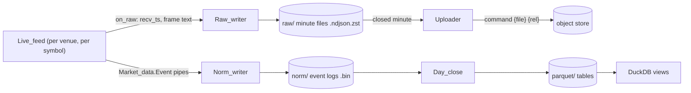

# Data platform

The data platform records live market data from the three venues and makes it queryable
with SQL. It is raw-first: the frames exactly as each venue sent them, with the local
receive time, are the system of record. Everything else (normalized event logs, Parquet
tables, candles) is derived and can be rebuilt.

Repositories: [parquet](../repos/parquet.md), [market-data](../repos/market-data.md),
[market-recorder](../repos/market-recorder.md), and the `Live_feed` modules of
[hl-client](../repos/hl-client.md), [binance-client](../repos/binance-client.md) and
[bybit-client](../repos/bybit-client.md). Decisions:
[ADR 0002](../adr/0002-raw-first-storage.md),
[ADR 0003](../adr/0003-parquet-pure-ocaml-writer.md),
[ADR 0004](../adr/0004-tardis-compatible-raw-format.md),
[ADR 0005](../adr/0005-command-based-uploader.md).



## Layers

| Layer | Format | Written by | Role |
| --- | --- | --- | --- |
| Raw minute files | `<recv_ts> <frame>` lines, zstd | `Market_recorder.Raw_writer` | System of record |
| Event log | length-prefixed `bin_prot` frames of `Market_data.Event` | `Market_recorder.Norm_writer` over `Market_data.Event_log` | Typed, fast replay (`Replay_feed`) |
| Parquet tables | Parquet v1, PLAIN, zstd | `Market_data.Day_close` (batch) or `Parquet_sink` (live) | Research and SQL |
| SQL | DuckDB views over `read_parquet` globs | `Market_data.Parquet_views`, `market-data query` | Ad-hoc analysis |

## File layout

Under the recorder's `data_dir`:

```text
raw/<venue>/<stream>/<symbol>/<YYYY>/<MM>/<DD>/<HH>-<MM>.ndjson.zst   raw minute files
<venue>/<symbol>/norm/<stream>/<YYYY-MM-DD>.bin                       event logs
<venue>/<symbol>/parquet/<table>/<YYYY-MM-DD>.parquet                 day-close output
<venue>/<symbol>/parquet/<table>/<YYYY-MM-DD>.<n>.parquet              live sink restarts
upload-pending.sexp                                                   upload queue
```

- `<venue>` is `hyperliquid`, `binance` or `bybit`; `<stream>` is `trades`, `bbo`,
  `l2` or `funding`; `<symbol>` is the venue's own name (`BTC`, `BTCUSDT`); `<table>` is a
  stream name or `candles`.
- Raw files are per UTC minute of `recv_ts`; event logs and Parquet per UTC day of
  `recv_ts`.
- The object store mirrors paths relative to `data_dir` (`{rel}` in the upload command).

## Raw line format

```text
2026-10-12T09:15:02.123456Z {"channel":"trades","data":[...]}
```

- `recv_ts` in ISO 8601 UTC with microseconds, one space, then the frame exactly as
  received. Newlines inside a frame are replaced by spaces so one line is one record.
- An empty line records a disconnect (written for every stream that received data when
  the recorder stops).
- One live feed is opened per venue entry and symbol, so every frame belongs to one
  symbol. Frames are stored per recorded stream: a Hyperliquid `l2Book` frame that feeds
  both `l2` and `bbo` is stored once under each; acknowledgements and pongs are stored
  too, since `on_raw` sees every frame before parsing.
- Lines are buffered and flushed every 250 ms or at 1 MiB. When a minute is over the
  file is closed, compressed to `.ndjson.zst`, the plain file removed and the
  compressed path queued for upload. A restart within the same minute appends a second
  zstd frame; `zstd -d` reads concatenated frames as one stream. On startup, plain files
  left by a crash are compressed and queued.

## Stable types

`Market_data.Trade`, `Bbo`, `L2_update`, `Funding`, `Candle`, `Stream` and the
re-exported `Price`, `Size`, `Side`, `Symbol` each have a `Stable.V1` with `bin_io`, and
a test pins every bin shape, so event logs written today stay readable. A change of shape
is a new `V2` with a converter, never an edit of `V1`. Event log files are append-only: a
crash leaves at most a partial last frame, which readers report and writers cut off.

## Parquet tables

Every table starts with `venue`, `symbol`, `exch_ts`, `recv_ts` (`TIMESTAMP_NS`);
prices and sizes are `DECIMAL(18,8)`.

| Table | Further columns |
| --- | --- |
| `trades` | `price`, `size`, `side` (taker), `trade_id` |
| `bbo` | `bid_price`, `bid_size`, `ask_price`, `ask_size` |
| `l2` | `seq`, `is_snapshot`, `side`, `level`, `price`, `size` (one row per level) |
| `funding` | `rate`, `next_funding_time`, `mark_price`, `index_price` |
| `candles` | `interval_ns`, `open_time`, OHLC, `volume`, `trade_count` (no timestamps) |

## Day close

`market-data day-close -dir <data_dir> [-date YYYY-MM-DD]` (default yesterday, UTC)
converts every instrument's `norm/` files of the day into `parquet/` tables and
one-minute candles.

- **Idempotent**: a table whose `<date>.parquet` is newer than its source is skipped
  (`-force` rewrites); a rewrite removes the numbered parts left by a restarted live
  sink.
- **Atomic**: files are written as `<name>.tmp` and renamed, so `*.parquet` globs never
  see a partial file.
- Re-running after late data, a fix in a normalizer or a schema change regenerates the
  day. In the Helm chart it runs as a CronJob at 00:20 UTC next to each recorder.

## SQL

`market-data views -dir D` prints one `CREATE VIEW` per table over
`D/*/*/parquet/<table>/*.parquet`; `market-data query -dir D "SQL"` runs them with the
`duckdb` CLI. DuckDB multiplies two `DECIMAL(18,8)` without widening, so cast to
`DECIMAL(38,16)` or `DOUBLE` first.

## Comparison with Tardis

| | Tardis (tardis.dev) | This platform |
| --- | --- | --- |
| System of record | Exchange-native messages with local timestamps | Same: `<recv_ts> <frame>` lines |
| Raw granularity | Per exchange, all channels mixed; one-minute slices from the `data-feeds` API | One file per venue, stream, symbol and minute |
| Disconnects | Empty line | Empty line |
| Compression | gzip over HTTP | zstd files |
| Normalized data | Daily CSV datasets (trades, incremental L2, snapshots, quotes, derivative ticker, liquidations) | Daily `bin_prot` event logs and Parquet (trades, bbo, l2, funding, candles) |
| Replay | `tardis-machine` server (HTTP and websocket replay of raw feeds) | `Market_data.Replay_feed` in-process; a replay server is planned |
| Query | CSV downloads, client libraries | DuckDB SQL over Parquet |
| Venues | Dozens | Hyperliquid, Binance USD-M, Bybit linear |
| Liquidations, options | Yes | No |

The Tardis column is from its public documentation and is not verified byte for byte;
in particular, the timestamp precision of Tardis lines is not checked against ours
(microseconds).

## Known gaps

- Nothing yet regenerates `norm/` from raw files: the pure normalizers exist in
  `binance-client` and `bybit-client` but no tool drives them over stored frames, so
  "rebuild from raw" is a design property, not yet a command.
- Event logs and Parquet are not uploaded by the recorder; in the Helm chart the
  day-close job uploads `parquet/`, and `norm/` lives only on the recorder volume.
- Reconnects happen inside the venue clients and are not visible through
  `Market_data.Feed.t`, so the recorder writes disconnect lines only on stop; a gap
  during a client reconnect is not marked in the raw files.
- `Market_data.Frame_log` (`raw/<stream>/<date>.binlog`) predates the recorder and is a
  second raw format the recorder does not use.
- One collector per venue: see
  [cloud-sinks-and-replication.md](cloud-sinks-and-replication.md) for replication.
