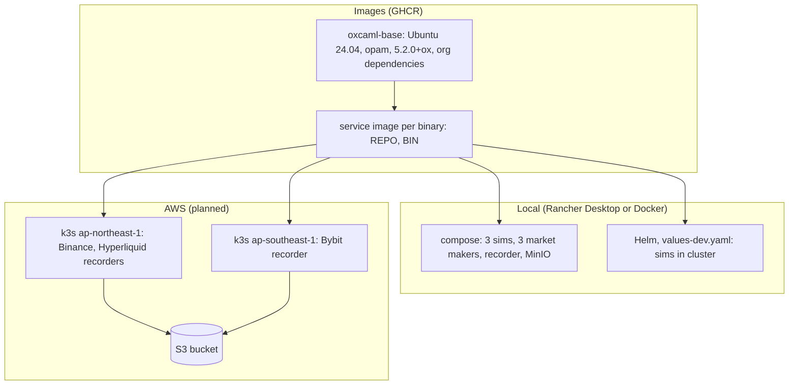

# Deployment

Kind: explanation.

How the OxCaml services run outside a developer's dune workspace: container images, a
local compose stack, a Helm chart, and the planned AWS topology. Everything here lives in
the [infra](../repos/infra.md) repository (status: in progress); the AWS part is design
notes, not automation.

## Images

- **`oxcaml-base`** (`images/oxcaml-base/Dockerfile`): Ubuntu 24.04, opam 2.5.1, the
  `5.2.0+ox` switch from the `ox` repository pinned to one commit, and the union of the
  organization's library dependencies (core, async, async_ssl, async_websocket preview,
  cohttp-async, cryptokit, zstd, ppx_jane, ppx_expect, base_quickcheck, ...). Built for
  linux/amd64 and linux/arm64 by `.github/workflows/base-image.yml` on changes and
  weekly, pushed as `ghcr.io/winterchill-trading/oxcaml-base:<date>` and `:latest`.
- **Service image** (`images/service/Dockerfile`, `build.sh REPO BIN`): stage one
  builds `FROM oxcaml-base`, fetches the repository (GitHub `main`, or a local checkout
  with `SRC=`), runs every `opam pin add` line of the repository's own CI workflow in
  order, and `dune build --release`; stage two is Ubuntu 24.04 with runtime libraries,
  optional `RUNTIME_PACKAGES` (rclone for the recorder), the binary as entrypoint, uid
  10001.

Because the service image replays the CI pin lines, a repository whose CI pin list is
incomplete also fails to build as an image (see the `hl-mm` and `market-maker` pages).

## Local

- **Compose** (`compose/docker-compose.yml`, `make up/down/logs/ps`): `hl-sim` (3000),
  `binance-sim` (3300), `bybit-sim` (3400), one `market-maker` per venue against them,
  `market-recorder` with `compose/recorder.sexp` recording the simulators and uploading
  with rclone to MinIO (9000, console 9001), and a one-shot job creating the
  `market-data` bucket.
- **Rancher Desktop**: dockerd (moby) engine so locally built images are visible to its
  k3s; Kubernetes enabled; at least 4 CPUs and 8 GB when building the base image.
  `helm install winterchill charts/winterchill -f charts/winterchill/values-dev.yaml` runs
  the simulators in the cluster and points the recorders at them, uploading to the
  compose MinIO through `host.rancher-desktop.internal`.
- **Tilt** (`Tiltfile`): rebuilds a service image from a sibling checkout on save and
  rolls its pods.

## Helm chart

`charts/winterchill`:

| Resource | Per | Purpose |
| --- | --- | --- |
| ConfigMap | venue | The recorder's sexp config, upload command rendered from `s3.*` |
| PersistentVolumeClaim | venue | Buffer for raw files until uploaded, and `norm/` for day close |
| Deployment (`Recreate`) | venue | One `market-recorder` with liveness on `/healthz` |
| Service | venue | Port 9100 for `/healthz` and `/metrics` |
| CronJob `day-close` | venue | 00:20 UTC: `market-data day-close` on the venue's volume (pod affinity to the recorder), then `rclone copy` of `parquet/` |
| Secret | release | S3 keys, only when not using the instance role |
| Simulators | `values-dev.yaml` | `hl-sim`, `binance-sim`, `bybit-sim` in cluster |

`charts/rendered-example.yaml` is `helm template` of the dev profile; CI fails if it is
stale, and runs `helm lint`, hadolint, shellcheck and `docker compose config`.

## CI

Every repository builds on GitHub Actions against the same toolchain as the base image:
the `ox` opam repository is pinned to the base image's commit in every workflow, and
`infra/scripts/check-pins.sh` fails when a workflow's commit or sibling pin order drifts.
Building the OxCaml compiler and the sibling dependencies from source takes about 17
minutes per push, so `infra` provides a composite action,
`winterchill-trading/infra/.github/actions/ox-setup@main`, that replaces the
setup-ocaml step, the `opam pin add` lines and `opam install --deps-only`
(`infra/docs/ci.md` has the migration recipe).

- **Inputs**: `pins` (one `name url` per line, in dependency order, optionally
  `#<ref>`), `with-test`, `working-directory`, and `ox-repository` (default: the base
  image's commit, so a bump in `infra` reaches every repository).
- **Cache key**: OS, architecture, runner image, compiler, `ox` commit, the pin names,
  the commits the pins resolve to (`git ls-remote` at the start of the run; pins are then
  added at exactly those commits) and the repository's `*.opam` files. The cached path
  is the whole local switch, saved right after the dependencies install, so a failing
  build still leaves a warm cache.
- **Restore**: an exact hit installs nothing; a partial hit (same compiler, `ox` commit
  and pin names) re-pins and `opam reinstall`s only the siblings whose commit moved, with
  their dependents; a miss builds everything. A push to `fixed-decimal` rebuilds every
  pin above it; a push to `hl-protocol` rebuilds only `hl-protocol`. A new `ox` commit,
  compiler or Ubuntu release is a full miss.
- **Size**: the saved switch is about 2.5 GB and restores in about 30 s. GitHub keeps
  10 GB per repository, so a busy repository keeps roughly the last dozen entries.

Timings on `ubuntu-latest` (hl-sim, five sibling pins, seconds, 2026-10-12):

| Run | setup-ocaml | Restore | Pins and dependencies | Save | Build and test | Job |
| --- | ---: | ---: | ---: | ---: | ---: | ---: |
| Cold, compiler not cached | 957 | 0 | 971 | 27 | 17 | 1973 |
| Cold, compiler cached | 43 | 0 | 959 | 27 | 16 | 1046 |
| Warm, exact hit | 34 | 31 | 2 | - | 23 | 91 |
| Partial, `hl-protocol` two commits back | 40 | 55 | 27 | 26 | 14 | 163 |

hl-sim's own CI uses the action since 2026-10-12 (a warm rerun took 117 s, against about
1020 s before). Rolling it out to the other repositories is in progress (see the
[roadmap](../roadmap.md)).

## AWS target (planned)

| Region | Venues | Reason |
| --- | --- | --- |
| `ap-northeast-1` (Tokyo) | Binance, Hyperliquid | Venue API front ends served from Tokyo |
| `ap-southeast-1` (Singapore) | Bybit | Bybit matching engine and API in Singapore |

- One small k3s cluster per region on EC2 (Graviton is fine: images are multi-arch),
  local-path PVCs, chrony with Amazon Time Sync (receive timestamps are only as good as
  the host clock), no inbound traffic, access through SSM.
- One bucket in `ap-northeast-1`; keys mirror the recorder's `data_dir` (`raw/...` every
  minute, `<venue>/<symbol>/parquet/...` daily). `raw/` moves to Glacier Instant
  Retrieval after 90 days; versioning with 30-day noncurrent expiry.
- Uploads use the EC2 instance role through rclone `env_auth` (IMDSv2, hop limit 2), with
  a write-only policy on `raw/*` and `*/parquet/*`.
- Queries: DuckDB with `httpfs` over `s3://` globs, or Athena with partition projection
  (nanosecond timestamp handling to be verified).
- Terraform or other infrastructure-as-code is out of scope for now.
- Redundant collectors in a second node or region are described in
  [cloud-sinks-and-replication.md](cloud-sinks-and-replication.md).

## Known gaps

- The base image workflow's first multi-arch build is still running; until it publishes,
  service images need a locally built base (`make base`, 40 to 90 minutes).
- `norm/` event logs stay on the recorder volume; the AWS notes suggest pruning them a
  week after day close.
- A `helm upgrade` restarts a recorder (`Recreate`), leaving a gap of a few seconds that
  only a second collector would cover.
