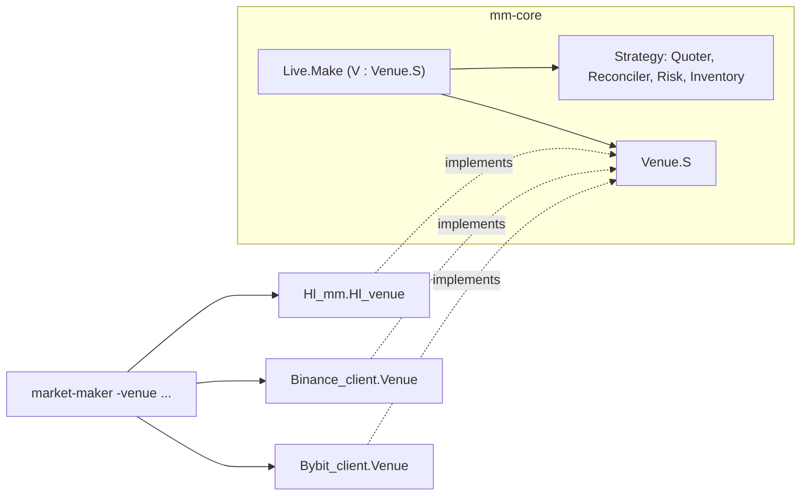

# Market making

Kind: explanation.

One strategy, three venues. `mm-core` holds a pure strategy and an Async event loop
parameterised by a venue signature; each venue client implements the signature; the
`market-maker` binary picks one at runtime.



## `Mm_core.Venue.S`

```ocaml
module type S = sig
  type t
  type config
  val connect : config -> t Or_error.t Deferred.t
  val instrument : t -> Symbol.t -> Instrument.t Or_error.t Deferred.t
  val books : t -> Symbol.t -> L2.t Pipe.Reader.t Deferred.t
  val fills : t -> Fill.t Pipe.Reader.t
  val order_updates : t -> Order_update.t Pipe.Reader.t
  val open_orders : t -> Symbol.t -> Open_order.t list Or_error.t Deferred.t
  val account : t -> Account_view.t Or_error.t Deferred.t
  val place : t -> Order_request.t list -> Order_status.t list Or_error.t Deferred.t
  val cancel : t -> Symbol.t -> Order_id.t list -> unit Or_error.t Deferred.t
  val cancel_all : t -> Symbol.t -> unit Or_error.t Deferred.t
  val on_reconnect : t -> f:(unit -> unit) -> unit
  val close : t -> unit Deferred.t
end
```

Contract (`venue.mli`):

- `fills` and `order_updates` are single readers buffered from `connect`; `books`
  returns a fresh reader per call.
- Fills are de-duplicated by trade id, at most once per connection, never from before
  `connect`, including across reconnects and resent snapshots.
- Implementations reconnect and resubscribe themselves, then run the `on_reconnect`
  hooks so the loop resyncs.
- `place` returns one `Order_status.t` per request in order; per-order rejections are
  `Rejected reason`, not `Error`. Cancelling an order that is already gone is not an
  error.
- `instrument` returns the tick valid at the current price where the tick depends on it.

## `Live.Make`

- `books` feed `Strategy.on_book`, `fills` feed `Strategy.on_fill` (de-duplicated again
  by trade id).
- `open_orders` and `account` are polled every `requote_interval_ms`, after every
  executed plan, when an order leaves the book, and after a reconnect.
- `Strategy.tick` runs after every book update, fill and poll; a plan becomes at most one
  `cancel` call and one `place` call.
- Ticks, plan execution and polls run one at a time on an Async sequencer; at most one
  tick and one poll wait in the queue, so a snapshot never predates a plan already sent.
- `stop` (SIGINT/SIGTERM or `-run-for`) cancels everything on the symbol, takes a final
  account snapshot and returns a `Report`. The position is not flattened.

## Strategy

- **Quoter**: simplified Avellaneda-Stoikov. Reservation price from the microprice
  skewed by normalized inventory `q` and a volatility risk term `gamma * sigma^2`;
  half-spread `base_half_spread_bps + v / 2`; `levels` per side spaced by
  `level_spacing_bps`; prices kept inside the book and strictly ordered; sizes capped so
  filling every quote cannot pass `max_position`.
- **Reconciler**: keeps a resting order that matches a quote's side and size, is within
  `requote_threshold_bps` and younger than `order_ttl_ms`; cancels the rest; places
  unmatched quotes as post-only (`Alo`). Client ids are `0x` + 32 hex digits encoding
  symbol, side, level and generation, valid on all three venues.
- **Risk**: sticky halts on position or drawdown breach (cancel all, then a reduce-only
  IOC at `mid -/+ flatten_slippage_bps`); non-sticky pauses on a one-sided book or stale
  data (cancel all).
- **Inventory**: average-cost accounting from fills, overwritten by account snapshots.

## Venue adapters

| `Venue.S` | Hyperliquid (`Hl_mm.Hl_venue`) | Binance (`Binance_client.Venue`) | Bybit (`Bybit_client.Venue`) |
| --- | --- | --- | --- |
| `config` | `Hl_client.Config.t` | `Binance_client.Config.t` | `Bybit_client.Config.t` |
| `connect` | `meta`, websocket with `orderUpdates` and `userFills` | `exchangeInfo`, user data stream, one combined market stream | public and private streams (key required) |
| `instrument` | tick from the mid: 5 significant figures, at most `6 - szDecimals` decimals | `PRICE_FILTER` tick, `LOT_SIZE` step, leverage from `positionRisk` | `instruments-info`, cached |
| `books` | `l2Book` snapshots | local book from `GET /depth` plus `@depth@100ms`, top 50 | `orderbook.50` merged by `Local_book`, gap resubscribes |
| `fills` | `userFills`, snapshot fills before connect dropped | `ORDER_TRADE_UPDATE` `x = TRADE`, once per trade id | `execution` topic, once per `execId` (via `Id_map`) |
| `order_updates` | `orderUpdates` | `ORDER_TRADE_UPDATE` status | `order` topic |
| `open_orders` | `openOrders` | `GET /fapi/v1/openOrders` | `GET /v5/order/realtime` |
| `account` | `clearinghouseState` | `GET /fapi/v2/account` + `positionRisk` | `wallet-balance` + `position/list` |
| `place` | one `order` action, rejections mapped by wording | `POST /batchOrders` per 5, `POST /order` for one | `create` or `create-batch` per 20, then read-back |
| `cancel` | one `cancel` action | `DELETE /order` per id; `-2011`/`-2013` ignored | `cancel` per id; `110001` ignored |
| `cancel_all` | `openOrders`, then one `cancel` action for them | `DELETE /allOpenOrders` | `cancel-all` |
| Signing | none (simulator only) | HMAC-SHA256 query signature | HMAC-SHA256 `X-BAPI-SIGN` |

The Hyperliquid adapter lives in its own repository (`hl-mm`) because `hl-client`
predates `mm-core`; the Binance and Bybit adapters live in their clients.

## Testing

- `mm-core`: expect and quickcheck tests of the strategy, and the live loop over an
  in-memory `Venue.S`.
- Each adapter runs the live loop against its simulator in its own test suite.
- `market-maker/scripts/e2e-all.sh` runs the binary for 60 s per venue against seeded
  simulators.
