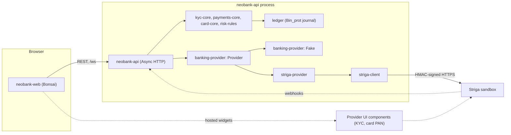
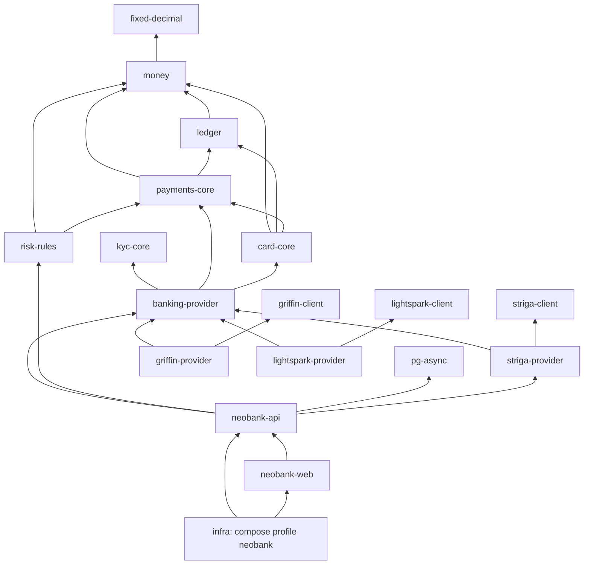
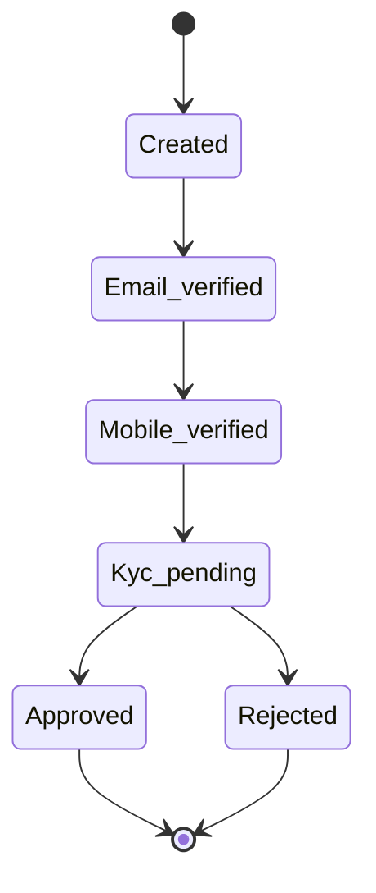
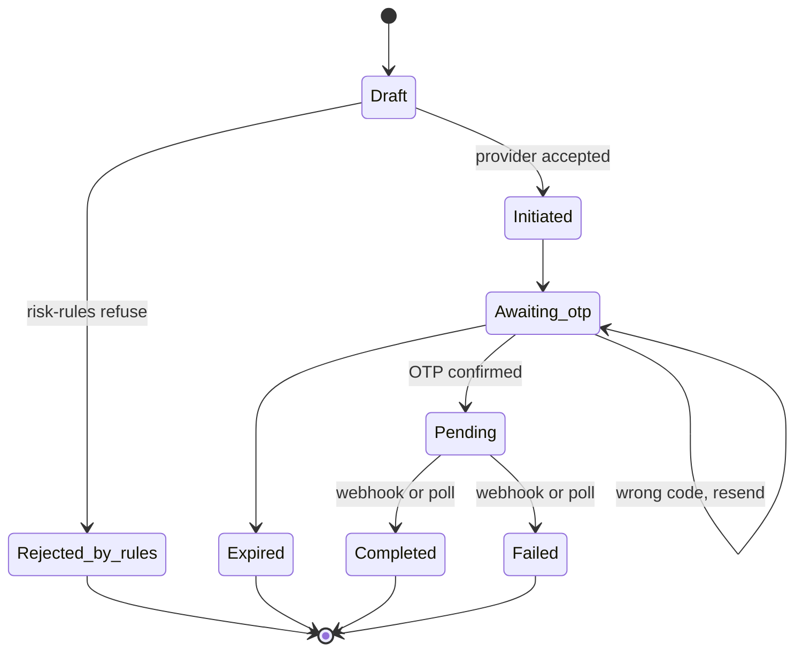

# Neobank demo

Kind: explanation.

Status: in progress (2026-10-14). `money`, `ledger`, `kyc-core`, `payments-core`, `card-core`,
`risk-rules`, `striga-client`, `banking-provider`, `risk-models` and `pg-async` are done;
`neobank-api` and `neobank-web` are done on the fake provider; `striga-provider` is done
for the sandbox, which never provisioned a EUR account for the test persons, and
`griffin-provider` (GBP) and `lightspark-provider` (USD) are done for their sandboxes, and
`neobank-api` has its Striga mode on `main`; the infra compose profile `neobank` is verified
with the fake provider. The store of `neobank-api` is PostgreSQL through `pg-async` behind
`Store.S`, a per-service store interface
([ADR 0009](../adr/0009-postgres-replaceable-store.md)); `hl-copy-api` uses the same store.
The bank-side domain is split into provider-neutral libraries named for what they are
(`money`, `ledger`, `kyc-core`, `payments-core`,
`card-core`, `risk-rules`, `banking-provider`); only the demo apps (`neobank-api`,
`neobank-web`) and the infra compose profile carry the neobank name. Everything below is the
design; repository pages are added as the repositories land.

The demo is a small retail neobank in OxCaml: a customer signs up, passes KYC, gets a EUR
IBAN and crypto wallets, funds the account by SEPA, holds and swaps BTC, ETH, USDC and
USDT, pays out by SEPA, on-chain and Lightning, uses a virtual card, sets up standing
orders and downloads statements. Accounts, payments and cards are provided by the
[Striga](https://docs.striga.com) API, used only in its sandbox. The bank-side logic
(customer, transfer and card state machines, risk rules and a double-entry ledger) is
ours, in libraries that know nothing of the demo or of Striga, and runs the same over
Striga or over a deterministic fake provider, so the whole demo
works offline and in CI.

Striga facts on this page come from its public documentation, linked inline and listed
under [Sources](#sources), as read on 2026-10-13. Statements marked "(unverified)" were not
found there and need a check against the sandbox before code relies on them.

## Scope

In the demo:

- Consumer onboarding: create the user, verify email and mobile, start KYC, approval
  (simulated in the sandbox).
- A EUR account with an IBAN, and wallets for BTC, ETH, USDC and USDT, with deposit
  addresses obtained by enriching each account.
- Funding by incoming SEPA (simulated in the sandbox) and by on-chain or Lightning deposit.
- Swaps between EUR and the crypto currencies at the provider's quoted rate.
- Payments: SEPA out, on-chain withdrawal with a fee estimate, Lightning withdrawal and
  invoice deposit, transfers between customers of the bank (intraledger).
- Virtual cards: create, freeze and unfreeze, spending limits, PAN display through the
  provider's UI components, card transactions (simulated in the sandbox).
- Standing orders, account statements, webhooks, strong customer authentication.

Stretch: Apple Pay provisioning of the virtual card (the provider documents mobile wallet
tokens; the demo has no signed iOS app, so this stays a stretch).

Out of scope: business customers (KYB), physical cards, production credentials, real
money, card disputes.

## User journeys

| Journey | Steps | Provider calls (planned) |
| --- | --- | --- |
| Onboard | Sign up, confirm email code, confirm SMS code, KYC in the hosted SDK, wait for the decision | Create user, verify email, verify mobile, start KYC (tier 1), KYC webhook; sandbox: simulate KYC result |
| Open accounts | After approval, the API creates a wallet and enriches the EUR and crypto accounts | Create wallet, enrich account (IBAN, deposit addresses) |
| Fund EUR by SEPA | The customer sees their IBAN; money arrives | Incoming transaction webhook; sandbox: simulate deposit |
| Hold crypto | Balances per currency, deposit address per wallet | Get wallets, enrich account |
| Swap | Quote, confirm, see both legs | Exchange rates, swap |
| Pay by SEPA | New beneficiary, amount, SMS OTP, status updates | Initiate SEPA payment, confirm with OTP, resend OTP, transaction webhooks; sandbox: simulate SEPA outcome |
| Pay on-chain | Address, fee estimate, OTP | Fee estimate, initiate withdrawal, confirm with OTP |
| Pay by Lightning | Paste an invoice, OTP; or create an invoice to receive | Lightning withdrawal, Lightning deposit, Lightning webhooks |
| Card | Create a virtual card, set limits, freeze, view PAN, see a purchase | Create card, block and unblock, limits, PAN consent; sandbox: simulate card authorization |
| Standing order | Monthly SEPA or crypto transfer, confirmed once with OTP | Create standing order, confirm, webhooks per execution |
| Statements | Per account and per card, by month | Account statements, card statements |

## Architecture

- `neobank-web` is a Bonsai app like [hl-copy-web](../repos/hl-copy-web.md)
  ([ADR 0008](../adr/0008-bonsai-web-frontend.md)): it talks only to `neobank-api`, and
  embeds the provider's hosted KYC and PAN components where those must run in the browser.
- `neobank-api` has the shape of [hl-copy-api](../repos/hl-copy-api.md): sessions,
  REST routes per journey, a `/ws` for status pushes, a webhook route that verifies the
  signature, normalizes the payload into a provider event and books it.
- The domain libraries hold no provider types and no demo concepts, so they can serve
  other products: `ledger` is meant to be reusable by exchange-core's clearinghouse later.
- `banking-provider` defines the `Provider` module type (Async, `Or_error`) over the
  domain types: everything the API needs from a provider. Its deterministic fake
  implements it in memory and simulates deposits, approvals and card activity on command.
- The store of `neobank-api` is PostgreSQL through [pg-async](../repos/pg-async.md), behind
  `Store.S`: the service's store interface, with an in-memory and a PostgreSQL implementation
  and one conformance suite over both ([ADR 0009](../adr/0009-postgres-replaceable-store.md)).
  It holds users, sessions, provider ids, transfer and card states, idempotency keys, outbox
  and inbox; the ledger journal stays a file outside the database.
- `striga-provider` implements `Provider` over `striga-client`, with a mapping table
  (which endpoint backs each operation, which webhook feeds which event) in its
  `docs/mapping.md`.
- Three real adapters exist, one per provider. Each is the only place that knows both its
  provider and `banking-provider`; each is sandbox by default and persists nothing itself.
  - `striga-provider`: EUR, SEPA, cards, KYC and crypto over `striga-client`.
  - [griffin-provider](../repos/griffin-provider.md): GBP, Faster Payments, book transfers and
    Confirmation of Payee over `griffin-client`. Conformance on the sandbox, 2026-10-14:
    4 passed, 7 failed. The failures are the suite's EUR account with an IBAN, which Griffin
    does not hold. The GBP walk passes.
  - [lightspark-provider](../repos/lightspark-provider.md): USD, USDC, USDT and USDB accounts,
    cross-border payouts with Grid's FX quotes, wallet and Lightning payouts and swaps over
    `lightspark-client`. Conformance on the Grid sandbox, 2026-10-14: 3 passed, 8 failed. The
    suite assumes an EUR account with an IBAN, which this platform does not offer. The USD walk
    passes.
  - The conformance suite is EUR-only, so the EUR scenarios are unverified for every provider
    until the suite takes a currency and rail.
- `striga-client` follows [griffin-client](../repos/griffin-client.md): `Config`, `Secret`,
  `Tls`, `Transport`, typed resources with stable JSON codecs, a `striga` CLI, a live test
  gated by `STRIGA_LIVE_TESTS=1`, and recorded, redacted fixtures for CI.

Dependency graph of the planned repositories, foundations first:

`neobank-web` depends on `neobank-api`'s shared request and response types only, as
hl-copy-web does on hl-copy-api's. The exact edges between the domain libraries are
planned and may tighten as the code lands.

Offline mode: `neobank-api` started with the fake provider needs no network and no
credentials; the web app's mock mode, the tests and CI use it. The same journeys then run
against the sandbox by switching the provider.

## Domain model

Planned contents per library:

| Library | Contents |
| --- | --- |
| `money` | Currencies (EUR, BTC, ETH, USDC, USDT with their decimals), amounts in minor units, crypto amounts through fixed-decimal, FX quotes |
| `ledger` | Double-entry postings, accounts with available and pending balances, append-only Bin_prot journal, replay to balances |
| `kyc-core` | Customer identity (id, email, phone), the tier state machine below, verification steps, PII minimization rules |
| `payments-core` | Transfer state machine per kind: `Sepa_out`, `Sepa_in`, `Onchain_out`, `Onchain_in`, `Lightning`, `Intraledger`, `Swap`, with an OTP/SCA step; standing orders |
| `card-core` | Card lifecycle (active, frozen, closed), authorizations and settlements, card limits |
| `risk-rules` | Per-transfer and daily caps, velocity, new-beneficiary cooldown, block lists |
| `banking-provider` | `Provider` module type over all of the above, normalized provider events, a deterministic fake provider for tests, offline mode and the web app's mock mode |

An outgoing transfer is created locally first, checked by `risk-rules`, sent to the
provider, then waits for the customer's OTP before the provider executes it; the final
state comes from a webhook or a poll, never from the initiating response alone.

## Data discipline

The ledger is the system of record for the bank side, with the same discipline as the
[data platform](data-platform.md):

- **Append-only Bin_prot journal.** Every entry is a balanced double-entry posting
  (debits equal credits per currency) with the event that caused it. The file starts with
  a header carrying the `bin_shape` digest of the stable entry type, like `market-data`'s
  `Event_log`, with the same compatible-digests rule
  ([ADR 0006](../adr/0006-compatible-event-log-digests.md)).
- **Every provider event is booked.** Webhooks, poll results and the responses to our own
  requests become normalized provider events and then journal entries; an event already booked
  (same provider id and state) is skipped, so webhook retries and polls are idempotent.
- **Replayable.** Balances, transfer states and card states are folds over the journal;
  a restart replays it and then reconciles against the provider's balances, recording any
  difference as an explicit adjustment entry rather than overwriting state.
- **Invariants under test.** A Quickcheck property drives random event sequences and
  checks that debits equal credits and that no balance goes negative except where an entry
  is flagged (a card settlement above its authorization, for example).
- **Pending and available.** Holds (card authorizations, initiated payouts) move funds to
  a pending account; settlement or release moves them back out, so available balance is a
  ledger query too.

## Security

- **HMAC request signing.** Every Striga request carries the API key header and an
  `Authorization: HMAC <ms timestamp>:<hex HMAC-SHA256>` over the timestamp, the method,
  the path without the `/api/v1` prefix and the hex MD5 of the body; a GET signs `{}` as
  its body ([authentication](https://docs.striga.com/reference/authenticating-with-the-api.md)).
  `striga-client` pins a test vector reproduced from the documentation's JavaScript sample.
- **Webhook verification.** Deliveries carry a `signature` header, an HMAC-SHA256 of the
  body keyed with the API key
  ([configuring webhooks](https://docs.striga.com/reference/configuring-webhooks.md));
  the API recomputes it over the raw body bytes and compares in constant time before
  parsing. The provider retries a delivery up to five times until it gets a 2xx, so the
  handler is idempotent (see above). Ordering is not documented, so the transfer state
  machines accept events out of order and ignore regressions.
- **OTP and SCA.** Money-moving operations are confirmed with an OTP; SMS OTP satisfies
  dynamic linking, TOTP does not for non-whitelisted EUR and USDC sends and swaps, and
  whitelisting a beneficiary needs SCA itself
  ([SCA](https://docs.striga.com/reference/strong-customer-authentication-sca.md)). The
  API never caches or logs a code; it forwards it once and keeps only the outcome. Login
  uses the provider's unified `/user/login/start` and `/user/login/complete` flow where the
  sandbox allows (unverified in the sandbox).
- **Secrets only from the environment.** Credentials are read from environment variables
  by `Config.of_env`, held in a `Secret` type that prints as `<redacted>`, never written to
  logs, fixtures, journals or CI; a committed `.env.example` lists the names with empty
  values.
- **Sandbox by default.** The client refuses any host other than the sandbox unless
  created with `~live:true`, and no binary in the demo passes it.
- **PAN never stored.** Card numbers are shown only through the provider's PAN UI
  components after a consent step confirmed by OTP
  ([card PAN UI components](https://docs.striga.com/reference/overview.md)); our servers
  see card ids, the last four digits and status, nothing more. The redaction layer also
  masks any PAN or IBAN beyond its last four characters in logs and errors.
- **PII minimization.** The API stores the customer's provider id, email and phone; names,
  addresses and documents go straight from the browser to the hosted KYC SDK. Fixtures use
  synthetic people and the sandbox's documented test phone numbers.
- **TLS host verification.** Every connection verifies the peer against a CA bundle and
  checks the host name, as `griffin-client`'s `Tls` does.

## Sandbox

The [sandbox simulator](https://docs.striga.com/reference/sandbox-simulator.md) triggers
what a sandbox user cannot cause: a KYC result (`PATCH /simulate/user/kyc`), an incoming
SEPA payment (`PATCH /simulate/accounts/deposit`), an outgoing SEPA outcome
(`PATCH /simulate/sepa`), a card authorization (`POST /simulate/card/authorization`) and a
test webhook (`POST /simulate/webhook/ping`). The fake provider in `banking-provider` offers the
same triggers, so
the end-to-end script runs the same journeys offline and against the sandbox. KYC tier 1 is
the starting tier; the demo treats tiers as 1 and 2 as the documentation suggests
([KYC tiers](https://docs.striga.com/reference/kyc-tiers.md)), and `risk-rules` takes its
caps from the tier.

## Repositories

| Repository | Role | Depends on (org) | Status |
| --- | --- | --- | --- |
| `money` | Currencies, minor units, exact amounts, FX rates, fees | [fixed-decimal](../repos/fixed-decimal.md) | done ([repo page](../repos/money.md)) |
| `ledger` | Double-entry, append-only Bin_prot journal, replay; reusable by exchange-core's clearinghouse later | `money` | done ([repo page](../repos/ledger.md)) |
| `kyc-core` | Customer identity and tier state machine, verification steps, PII minimization | (none) | done ([repo page](../repos/kyc-core.md)) |
| `payments-core` | Transfer state machines (SEPA, on-chain, Lightning, intraledger, swap), OTP/SCA step, standing orders | `money`, `ledger` | done ([repo page](../repos/payments-core.md)) |
| `card-core` | Card lifecycle, authorizations and settlements, limits | `money`, `ledger`, `payments-core` | done ([repo page](../repos/card-core.md)) |
| `risk-rules` | Rule engine for transfers and card authorisations: caps, typologies, SCA exemptions, shadow mode, review queue | `money`, `payments-core` | done ([repo page](../repos/risk-rules.md)) |
| `risk-models` | Machine-learned scores through `risk-rules`' `Model.S`; trained offline, scored in OCaml | `risk-rules` | done ([repo page](../repos/risk-models.md)) |
| `pg-async` | Non-blocking PostgreSQL client for Async over libpq: pool, parameterized queries, transactions, migrations | (none) | done ([repo page](../repos/pg-async.md)) |
| `banking-provider` | `Provider` module type over the domain libraries, deterministic fake provider | `money`, `ledger`, `kyc-core`, `payments-core`, `card-core` | done ([repo page](../repos/banking-provider.md)) |
| `striga-client` | Striga SDK and `striga` CLI: HMAC transport, typed resources, simulator, webhook verification | (none) | done ([repo page](../repos/striga-client.md)) |
| `striga-provider` | `Provider` over `striga-client`, endpoint and webhook mapping table | `banking-provider`, `striga-client` | done, sandbox-limited ([repo page](../repos/striga-provider.md)) |
| `griffin-provider` | `Provider` over `griffin-client` for GBP: UK customers, sort-code accounts, Faster Payments, Confirmation of Payee | `banking-provider`, `griffin-client` | done, sandbox-limited ([repo page](../repos/griffin-provider.md)) |
| `lightspark-provider` | `Provider` over `lightspark-client` for USD: Grid customers, USD and stablecoin accounts, cross-border payouts, FX quotes, swaps | `banking-provider`, `lightspark-client` | done, sandbox-limited ([repo page](../repos/lightspark-provider.md)) |
| `neobank-api` | Async HTTP API, sessions, webhooks, `/ws`; the demo server; state in PostgreSQL through `pg-async` | `banking-provider`, `risk-rules`, `striga-provider`, `pg-async` | done on the fake provider; Striga mode on `main` ([repo page](../repos/neobank-api.md)) |
| `neobank-web` | Bonsai frontend, mock mode on the fake provider | `neobank-api` types | done ([repo page](../repos/neobank-web.md)) |
| `infra` | Compose profile `neobank`: API, web, fake or sandbox provider | the images above | verified with the fake provider |

CI pin order (planned), following the graph: fixed-decimal, money, ledger, kyc-core,
payments-core, card-core, risk-rules, banking-provider, striga-client, striga-provider,
griffin-client, griffin-provider, lightspark-client, lightspark-provider, pg-async,
neobank-api. CI has no credentials; live tests are skipped with one line and the suites run on
recorded, redacted fixtures and the fake provider.

## Open questions

- What `STRIGA_APPLICATION_ID` and `STRIGA_UI_SECRET` are for: the KYC SDK, the PAN UI
  components or neither. `striga-client`'s `docs/api-notes.md` will record the answer.
- Webhook signing is keyed with the API key per the documentation; is there a separate
  webhook secret per application, and does the HMAC cover the raw bytes or a re-serialized
  JSON body (the sample hashes `JSON.stringify(payload)`)?
- Can the sandbox send webhooks to a local endpoint, or does the demo poll and use the
  simulator's ping only? Registering webhook endpoints is an account-level setting the
  demo does not change.
- Does the sandbox enforce SCA on login and balance reads, and which factors work there?
- `fixed-decimal` has 10^-8 precision: enough for BTC (8 decimals) and USDC and USDT
  (6), not for ETH (18). Either ETH amounts are rounded to 10^-8 at the edge or `Money`
  carries its own wider integer for ETH; `money` decides.
- Which webhook carries a swap's final rate and fee, so the ledger books both legs from
  the provider's numbers instead of the quote?
- Standing orders: does each execution produce its own transaction webhook, and how is a
  failed execution reported ([standing order webhook sequence](https://docs.striga.com/reference/standing-order-webhook-sequence.md))?
- Apple Pay provisioning needs mobile wallet tokens and an app; is a web-only demo of the
  token flow worth building?

## Sources

- [Authentication](https://docs.striga.com/reference/authenticating-with-the-api.md):
  API key header and HMAC request signature.
- [Configuring webhooks](https://docs.striga.com/reference/configuring-webhooks.md):
  `signature` header, HMAC-SHA256 with the API key, up to five retries.
- [Sandbox simulator](https://docs.striga.com/reference/sandbox-simulator.md):
  simulated KYC, deposits, SEPA outcomes, card activity, webhook ping.
- [KYC tiers](https://docs.striga.com/reference/kyc-tiers.md): tier 1 start, limits,
  tier 2 upgrade.
- [Strong customer authentication](https://docs.striga.com/reference/strong-customer-authentication-sca.md):
  factors, dynamic linking, trusted beneficiaries, unified login.
- [Card PAN UI components](https://docs.striga.com/reference/overview.md): create,
  request consent, render.
- [Creating deposit credentials](https://docs.striga.com/reference/creating-deposit-credentials.md):
  account enrichment for IBANs and deposit addresses.
- [Standing order webhook sequence](https://docs.striga.com/reference/standing-order-webhook-sequence.md).
