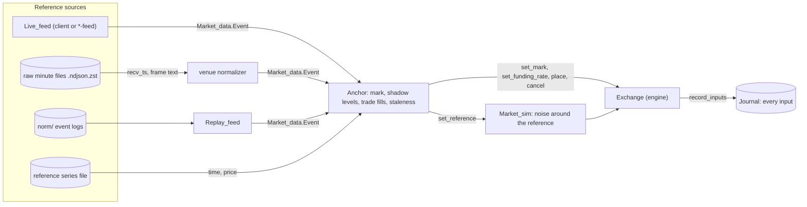

# Price anchor

Kind: explanation.

Status: library done in [price-anchor](../repos/price-anchor.md) (mark, funding, shadow
levels, trade replay, staleness, live / raw / norm / series sources). Simulators wired:
`hl-sim` (`-anchor`, `-anchor-raw`, `-anchor-norm`, `-anchor-speed`; live references
through the Hyperliquid and Binance clients, anchor status on `GET /status`, engine
inputs journaled with `-input-journal`), `binance-sim` (`-anchor`, `-anchor-raw`,
`-anchor-norm`, `-anchor-speed` with the server clock at the replay speed, Binance
references only, `GET /sim/anchor`; binary in the `binance-sim-anchor` package),
`bybit-sim` (`-anchor`, `-anchor-raw`, `-anchor-norm`, `-anchor-speed`; live references
through the Bybit and Binance clients, `GET /sim/anchor`, `-input-journal`; binary in the
`bybit-sim-anchor` package), and the TradFi path in `cme-sim`, `nyse-sim` and `cboe-sim`
(series, fixed and scaled references, mean reversion while open, waiting through
auctions, pauses and halts; `nyse-sim` keeps the target inside the LULD bands, `cboe-sim`
takes its LULD reference from the mean of its own prints over five minutes). `cboe-sim`
runs on `Anchor` itself (one per anchored listing, `path`, `may_engage`, `last_trade`
from its last print, `clamp` with `Clamp.within_bands` on its LULD bands); its own
`Anchoring` module is a thin wrapper. `cme-sim` does the same (one `Anchor` per
anchored product, `may_engage` while the product is open, `last_trade` from the venue's
last price, `clamp` with `Clamp.within_bands` on its daily price limits), and so does
`nyse-sim` (one `Anchor` per anchored listing, `may_engage` in continuous core trading
outside imbalance periods and LULD pauses, `last_trade` from the venue's last trade,
`clamp` with `Clamp.within_bands` on its LULD bands). The
design is built over interfaces that exist (`Exchange_core_engine.Exchange`, `Journal`,
`Stepped`, `Market_sim`, `Market_data.Feed`, `Market_data.Raw_reader`) plus the additions
listed under
[Changes to existing repositories](#changes-to-existing-repositories).

The simulators' prices come from `Market_sim`, a seeded random walk with noise traders
around it. Strategies tested on them see no real market structure: no real spread, depth,
trade flow or volatility regime. The price anchor ties a simulator's market to a
reference market, live or recorded, using only the engine's public interface, so the
anchored run is still deterministic and journaled.

## Sources

The anchor consumes `Market_data.Event.t` values (trades, BBO, L2, funding) with their
`recv_ts`, whatever their origin:

- **Live**: a `Market_data.Feed.t` from a client's `Live_feed` (`hl-client`,
  `binance-client`, `bybit-client`) or a `*-feed` repository. The same feed the recorder
  uses.
- **Recorded raw files**: the recorder's `raw/<venue>/<stream>/<symbol>/.../<HH>-<MM>.ndjson.zst`
  minute files, the system of record. A reader decompresses each minute, splits
  `<recv_ts> <frame>` lines, merges the streams of one symbol by `recv_ts`
  (`Market_data.Merge`) and passes each frame to the venue's pure normalizer
  (`Binance_client.Feed_normalizer`, `Bybit_client.Live_feed.Normalizer`), the code
  `Live_feed` runs live. An empty line (a disconnect) is passed on as a gap. This reader
  is the same tool the roadmap's raw-to-norm item needs; the anchor is its first user.
- **Recorded event logs**: `Market_data.Replay_feed` over `norm/`, already a `Feed.t`.
  Cheaper than raw files, but only as faithful as the normalizer that wrote them.
- **Reference series**: a file of `(time, price)` points, for venues with no data
  source (the TradFi simulators).

An anchor maps one reference instrument (`binance:BTCUSDT`) to one simulator symbol, with
a price factor and a size factor for listings in other units (from
`Market_data.Contract_units`: `1000PEPEUSDT` against `kPEPE`). Prices are rounded to the
simulator instrument's tick (bids down, asks up) and sizes down to its lot; levels that
round to zero size are dropped.

## Time and determinism

The anchor never reads the wall clock. Each reference event is applied at
`sim_time = recv_ts + offset`, where the offset is fixed when the anchor starts (live: the
current exchange time minus the first event's `recv_ts`; recorded: chosen so the first
event lands at the run's start). Before applying an event the anchor calls
`Exchange.step ~now:sim_time` if the exchange clock is behind, so funding and liquidation
happen in order.

Every anchor action goes through `Exchange` functions that report an `Input.t` to the
input recorders (`set_mark`, `set_funding_rate`, `deposit`, `place`, `cancel`, `step`).
A `Journal` attached to the exchange therefore records the anchored run completely, and
`Journal.replay` reproduces it bit for bit without the reference data: a live anchored
session can be journaled, kept and replayed offline. Changes made through `Market_sim`
are themselves exchange calls, so they are journaled too.

## Mark price

On each reference event the anchor updates its reference price:

1. the venue's mark price, if the source carries one (`Funding.mark_price`);
2. else the BBO mid, or the L2 mid;
3. else the last trade price.

It calls `Exchange.set_mark` when the reference price changes by at least one tick, at
most once per `mark_interval` (default 100 ms, the simulators' tick interval). Liquidation
follows the anchored mark, as it does today on the random walk. `Market_sim` gets the same
price through `set_reference`, so noise traders quote around the real price instead of
their own walk.

Funding: when the source carries a funding rate, `Exchange.set_funding_rate` is called
with it, converted to the simulator's funding interval
(`rate * sim_interval / venue_interval`).

## Shadow top-N levels

An anchor account (`anchor:<venue>:<symbol>`, deposited with a large balance at start)
keeps the reference book's top `N` levels per side (default 5) resting in the simulator's
book. On each L2 or BBO update the anchor computes the desired levels and reconciles them
with its own resting orders, as `Mm_core.Reconciler` does for quotes: keep orders whose
price and size match, cancel the rest, place the missing ones. Orders are post-only
(`Alo`): a shadow level that would cross a simulated client's resting order is skipped
until the next update, so the anchor never takes liquidity from a simulated client.

Simulated takers fill against shadow levels like any resting order: the anchor account
takes the other side, and the filled size stays consumed until the reference size at
that price changes. Without this, a simulated client could take the same real liquidity
again on every update. `Market_sim` noise traders may still post, but with shadow levels
present their orders are mostly behind real size; the default for an anchored instrument
is no noise traders.

Queue position: a simulated order placed at a price where the anchor shows size `q` is
behind `q`. The anchor keeps a per-order `queue_ahead`, decremented by reference trades
at that price and capped by the reference size when it drops. Trade-replay fills (below)
use it.

## Trade-replay fills

Passive simulated orders must fill when the real market trades through them, not only
when another simulated client takes them. For each reference trade at price `p` with
taker side `s` and size `q`:

1. Find simulated resting orders on the passive side at or through `p` (bids at or above
   `p` for a sell trade). Orders strictly through `p` are eligible for their full size;
   orders at `p` only for `q` minus their `queue_ahead`.
2. Cancel the anchor's own shadow orders at those prices, so they are not filled
   instead.
3. Place an IOC limit order at `p` for the eligible size from a second anchor account
   (`anchor-taker:<venue>:<symbol>`). It must be a separate account: the engine's
   self-trade prevention would stop it at the anchor's own resting order
   (`Cancel_taker`, Binance and Bybit simulators) or cancel that order (`Expire_maker`,
   Hyperliquid simulator).
4. Re-place the shadow levels from the current reference book.

The four steps run in one go on the scheduler thread (or inside one `Stepped` step), so
no simulated client sees the book in between. The two anchor accounts accumulate
positions; their balances are large enough that liquidation does not trigger in practice,
and their positions are excluded from any report.

## Staleness

A reference is stale when no event arrived for `max_staleness` (default 5 s for live
sources, measured on `recv_ts` for recorded ones), when the source reports a gap (an
empty raw line, a `Live_feed` resync), or before the first L2 snapshot. While stale, the
anchor:

- cancels its shadow levels and stops trade replay;
- stops calling `set_mark`, so the mark stays at the last reference price;
- hands the reference back to `Market_sim`'s random walk from the last price, if the
  instrument has noise traders.

It becomes fresh again on the next full L2 snapshot (or, for BBO-only sources, the next
BBO) and re-places the shadow levels at once. Each transition is logged and counted, so
an anchored run reports how long it was stale.

## Crypto simulators

`hl-sim`, `binance-sim` and `bybit-sim` run the anchor in process as a library, on the
Async scheduler thread that already runs the engine, after the adapter steps the clock.

- **Live**: `-anchor binance:BTCUSDT=BTCUSDT` subscribes to that instrument through the
  client's `Live_feed` (any venue for any simulator: `hl-sim` BTC can follow Binance) and
  applies mark, shadow levels and trade fills.
- **Recorded**: `-anchor-raw DIR -anchor-from T -anchor-to T` reads the recorder's raw
  minute files through the normalizer; `-anchor-norm DIR` reads event logs through
  `Replay_feed`. `-anchor-speed` paces recorded time against the wall clock (0 runs as
  fast as clients allow).
- **Offline**: `Stepped` with `Config.sim = None` and the anchor fed all reference
  events up to each step's time before the strategy reacts. An `mm-core` strategy then
  runs against a recorded real market with simulated fills, and `Stepped.check_replay`
  checks the whole run.

The simulators' venue rules (ticks, lot sizes, minimum notional, fee schedules) stay
their own; only prices, depth and trade flow come from the reference.

## TradFi simulators

`nyse-sim`, `cboe-sim` and `cme-sim` have no free real-time source, so there is no real
depth or trade flow to shadow or replay. They keep noise traders as the book's only
liquidity and anchor the noise to a chosen reference price:

- The reference is a reference series file, or a scaled recorded crypto or index-proxy
  series chosen by the operator, or a fixed start price with a drift. `Market_sim`'s walk
  becomes mean-reverting around it: each tick the noise reference moves by its random
  step plus a pull of `(anchor - reference) / half_life` toward the anchor price.
- `set_mark` follows the anchor only during the open phases of the venue's session clock
  (`equities-core` `Session`); during auctions, LULD pauses and CME limit halts the venue
  layer owns the price and the anchor waits.
- LULD reference prices (NYSE, Cboe) and CME daily price limits keep coming from the
  simulators' own trades and settlements, which now follow the anchor.
- Shadow levels and trade replay are off; if a real data source for these venues becomes
  available, the crypto path applies unchanged.

Each TradFi simulator first wrote its own `Anchoring` module because `Anchor` lacked the
TradFi controls. `Anchor.create` now has them, so the simulators can share the library:
`?half_life` (set the reference through `Market_sim.set_reference ~half_life` instead of
pinning), `?may_engage` (asked before each mark or reference update; on the first refusal
the anchor calls `clear_reference` once and then counts waits) with `?last_trade` (where
the walk restarts when the venue allows the anchor again), `?step_clock:false` (the venue
owns its clock), and a series alone is never stale between its points unless
`max_staleness` is given. `Source.of_series` returns an error for a missing or malformed
file.

## Changes to existing repositories

- `exchange-core`: `Market_sim.set_reference` (replace a symbol's walk with an external
  price, optionally with a mean-reversion half-life) and a per-symbol noise trader count.
  Both are exchange calls through existing inputs, so journals keep working.
- `hl-client`: expose its frame normalizer as a pure module, as `binance-client` and
  `bybit-client` do, so raw Hyperliquid files can be decoded offline.
- `market-data` or a new repository: the raw minute file reader and merge.
- Each `*-sim` binary: the `-anchor*` flags.

## Open questions

- Library inside each simulator (chosen above) or a separate process driving the
  simulators over their APIs: a process needs no simulator changes but cannot place
  shadow and trade-replay orders atomically with the clock.
- Whether the shadow size consumed by simulated takers should come back after a fixed
  time, as real liquidity refills, rather than only on the next reference change.
- How to account for the anchor accounts' positions when a simulated strategy's PnL is
  compared with the real venue's.
- When the TradFi simulators move from their own `Anchoring` modules to `Anchor`. Nothing
  is missing in the library any more; the price-anchor README's "TradFi migration" table
  maps every function and counter. Known differences: `Stats.marks_set` counts changes
  rather than every tick, `resumes` does not count the first follow, and
  `Source.to_path` keeps the first change per interval where `cboe-sim` kept the last
  per bucket.
- Resolved: the reference as a function of venue time (fixed prices with a drift, series
  pulled on the venue's clock) is `Path`, passed as `Anchor.create ~path`; keeping the
  target inside LULD bands or daily limits is `Anchor.create ~clamp`, with
  `Clamp.within_bands` as the ready-made function (`Stats.clamped` counts its moves).
- Resolved: the TradFi controls (half-life, pause on venue phases, venue-owned clock,
  series without silence staleness) live in `Anchor`, so the TradFi path needs no
  second library.
