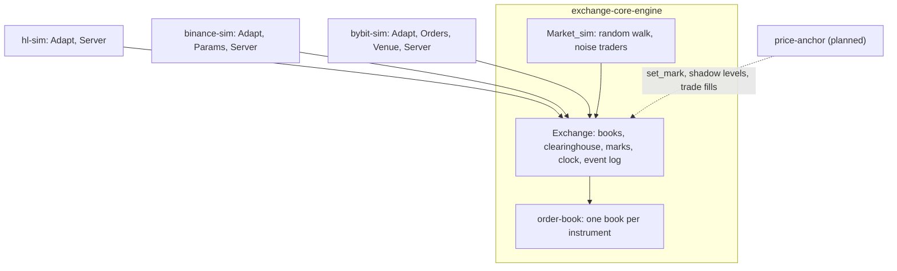

# Simulators

Kind: reference.

Three venue simulators share one engine. `exchange-core-engine` does matching, margin,
funding, liquidation and synthetic order flow; each `*-sim` is an adapter that speaks one
venue's HTTP and websocket API over it. Clients and the market maker run unchanged
against a simulator or the real venue.

## The engine

`Exchange_core_engine.Exchange` owns one `Order_book` per instrument, a `Clearinghouse`,
marks, id counters, a clock and an event log.

- **Determinism.** Time is an `int` of nanoseconds advanced by the caller with
  `Exchange.step ~now`; the engine never reads the wall clock. Order and trade ids are
  sequential; every `place` consumes an order id, even when rejected.
- **Validation order**: known symbol; price positive, on tick, within the
  significant-figure limit; size a positive multiple of the lot; no duplicate client id
  among resting orders; reduce-only clipped to the position; minimum notional; margin.
- **Matching**: price-time priority, maker-price fills, self-trade prevention that
  cancels the taker's remainder. Market orders are IOC orders `slippage_bps` (default 5%)
  through the best opposite price.
- **Margin**: cross margin, one-way positions. Initial margin `notional / leverage`
  (resting orders reserve theirs); maintenance `notional / (2 * max_leverage)`.
- **Mark price**: the last `set_mark`, else the last trade, else the book mid.
- **Liquidation**: on `set_mark` and `step`, accounts below maintenance are closed at
  mark and their orders cancelled; no backstop.
- **Funding**: charged at each funding boundary crossed by `step`, at a configured
  per-instrument rate (`set_funding_rate`), not a premium index.
- **Events**: `drain_events` returns order accepted/rejected/filled/cancelled, fills,
  liquidations and funding, which the adapters turn into websocket pushes.
- **Market simulation**: `Market_sim.tick` advances a seeded geometric random walk per
  instrument, sets the mark to it, and lets noise traders (accounts `0x` + 32 `f` +
  index, $10M each) post GTC orders up to 25 bps away, cancel old ones and send small
  market orders. Reproducible for a seed and the same sequence of external requests.

## The adapters

All three run the engine on the Async scheduler thread (no locking), step the engine
clock to the wall clock before each request and on a 1 s timer, tick the market
simulation every 100 ms, and publish the events a request produced to websocket
subscribers right after it. Each serves HTTP and websockets on one port (cohttp-async
`Expert` upgrade handed to async_websocket).

| | hl-sim | binance-sim | bybit-sim |
| --- | --- | --- | --- |
| Default port | 3000 | 3300 | 3400 |
| Universe | BTC, ETH, SOL (asset 0, 1, 2) | BTCUSDT, ETHUSDT, SOLUSDT | BTCUSDT, ETHUSDT, SOLUSDT |
| Account identity | `X-Address` header, else `vaultAddress`, else `0x...01` | `X-MBX-APIKEY` header | `X-BAPI-API-KEY` header; websocket `auth` op |
| Signature | not verified | `signature`, `recvWindow` ignored; `timestamp` required | `X-BAPI-SIGN` ignored; `X-BAPI-TIMESTAMP` checked against recv window |
| First use | credited `-initial-balance` USD | credited USDT | credited USDT |
| REST | `POST /info`, `POST /exchange` | `/fapi/v1/...`, `/fapi/v2/account`, `positionRisk`, listen key | `/v5/market/...`, `/v5/order/...`, `/v5/execution/list`, `/v5/position/list`, wallet |
| Websocket | `/ws`: `l2Book`, `trades`, `orderUpdates`, `userFills`, `allMids` | `/ws/<stream>`, `/stream?streams=`, `/ws/<listenKey>` | `/v5/public/linear`, `/v5/private` |
| Book stream | full `l2Book` snapshots, at most every 50 ms | `depthUpdate` diffs every 100 ms with `U`/`u`/`pu` sequencing | snapshot then deltas, `u` +1 per message, coalesced 20 ms |
| Fees | taker 3.5 bps, maker 1 bp | taker 5 bps, maker 2 bps | taker 5.5 bps, maker 2 bps |
| Funding | engine default, hourly | every 8 h at 0.01% | every 8 h at 0.01% |

### Time in force and market orders

The engine knows three times in force (`Exchange_core.Tif`: `Gtc`, `Ioc`, `Alo`) and
`Market { slippage_bps }`, an IOC order priced `slippage_bps` through the best opposite
price (`Order_book.market_limit_px`), rejected with `No_liquidity` when the opposite side
is empty. Every simulator keeps the engine default of 500 bps (5%,
`Exchange.Config.market_slippage_bps`). Each adapter maps its venue's vocabulary onto
these:

| | hl-sim | binance-sim | bybit-sim |
| --- | --- | --- | --- |
| Venue TIFs accepted | `Gtc`, `Ioc`, `Alo` (passed through) | `GTC`, `IOC`, `FOK`, `GTX`; `GTD` and `RPI` rejected (`-1115`) | `GTC`, `IOC`, `FOK`, `PostOnly`; `RPI` rejected (10001) |
| Default TIF | none: the wire requires one | none: `LIMIT` requires `timeInForce` | `GTC`; market orders are `IOC` |
| Post only | `Alo`: rejected with "Post only order would have immediately matched, bbo was ..." | `GTX` to engine `Alo`: `-5022` | `PostOnly` to engine `Alo`: accepted, then cancelled with `EC_PostOnlyWillTakeLiquidity` |
| FOK | not a venue TIF | checked against the opposite depth up to the limit price (own orders included), then sent as engine `Ioc`; unfillable: `-5021`, not recorded | checked with `Adapt.fok_fillable` (own orders included), then engine `Ioc`; unfillable: accepted, then cancelled with `EC_NoEnoughQtyToFill` |
| IOC with no fill | error "Order could not immediately match against any resting orders." | `EXPIRED` order in the response, not kept | accepted, then cancelled with `EC_NoImmediateQtyToFill` |
| IOC remainder | cancelled; status `Filled` for the filled part | `EXPIRED` with the executed quantity | cancelled after the fills |
| Market orders | not on the wire: clients send an `Ioc` limit priced through the book, as the SDKs do; `Adapt.market_order` exposes the engine's market order for tests | `MARKET`: engine market order, 5% through the best opposite price; `MARKET_LOT_SIZE` bounds the size | `Market`: engine market order, 5% through the best opposite price |
| Amend or modify | cancel, then place the replacement with a new oid (same TIF) | not served | the replacement rests as `Gtc` (or `Alo` for `PostOnly`), whatever the original TIF |
| Self-trade (engine cancels the taker remainder) | nothing filled: error "Order would have matched against own resting order." | nothing filled: `-2010`; a cancelled remainder: `EXPIRED_IN_MATCH` on the user stream | accepted, then cancelled with `EC_BySelfMatch` |

A FOK order is checked and then sent as IOC in two steps on the scheduler thread, so
nothing runs between them; self-trade prevention can still cut it short when the depth
that made it fillable includes the account's own orders.

Venue specifics (error wording and codes, status mapping, id formats) live in each
adapter's `Adapt` module; see the `repos/` pages for the gaps of each simulator.

## Planned: price-anchor

The simulators' prices come from a random walk, so strategies tested on them see no real
market structure. `price-anchor` is planned to tie a simulator's market to a real venue
(live through a client's `Live_feed`, or recorded through `market-data`'s
`Replay_feed`). It would use only the engine's public interface:

- **Mark price**: `Exchange.set_mark` from the real venue's mark (funding stream) or
  mid, replacing the random walk's reference; liquidation and funding follow it.
- **Shadow top-N levels**: an anchor account keeps the real top N bid and ask levels
  resting in the simulator's book, cancelling and replacing on each real L2 update, so
  simulated takers see real depth and simulated makers queue behind real size.
- **Trade-replay fills**: each real trade at or through a simulated resting order's
  price fills that order against the anchor account, so passive orders fill when the real
  market trades through them, not only when another simulated client takes them.

Open questions: whether the anchor account is exempt from margin, how simulated orders
that cross the shadowed levels are filled (against shadow size, then removed until the
next real update), queue position against shadow size at the same price, and whether it
is a library used by each `*-sim` binary or a separate process talking to the simulators
over their APIs. No repository exists yet.
