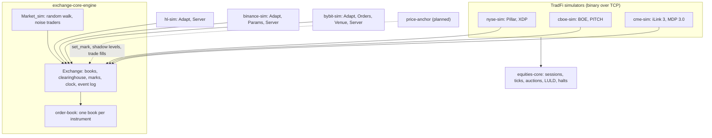

# Simulators

Kind: reference.

Six venue simulators share one engine. `exchange-core-engine` does matching, margin,
funding, liquidation and synthetic order flow; each `*-sim` is an adapter that speaks one
venue's API over it. The three crypto simulators speak HTTP and websocket JSON, and
clients and the market maker run unchanged against a simulator or the real venue. The
three TradFi simulators speak the venues' binary order entry and market data protocols
over TCP, with US equities and futures rules from `equities-core`.

## The engine

`Exchange_core_engine.Exchange` owns one `Order_book` per instrument, a `Clearinghouse`,
marks, id counters, a clock and an event log.

- **Determinism.** Time is an `int` of nanoseconds advanced by the caller with
  `Exchange.step ~now`; the engine never reads the wall clock. Order and trade ids are
  sequential; every `place` consumes an order id, even when rejected.
- **Validation order**: known symbol; price positive, on tick, within the
  significant-figure limit; size a positive multiple of the lot; no duplicate client id
  among resting orders; reduce-only clipped to the position; minimum notional; margin.
- **Matching**: price-time priority, maker-price fills, self-trade prevention chosen per
  exchange (`Exchange.create ?self_trade`): `Cancel_taker` (the default; Binance and Bybit
  simulators) cancels the taker's remainder, `Expire_maker` (Hyperliquid simulator)
  cancels the resting own order with a `Self_trade` cancel event and keeps matching the
  taker. Market orders are IOC orders `slippage_bps` (default 5%)
  through the best opposite price.
- **Margin**: cross margin, one-way positions. Initial margin `notional / leverage`
  (resting orders reserve theirs); maintenance `notional / (2 * max_leverage)`, or by
  margin tier when the instrument has tiers (Hyperliquid simulator), where `set_leverage`
  also respects the tier of the current position.
- **Mark price**: the last `set_mark`, else the last trade, else the book mid. An oracle
  price (`set_oracle`, Hyperliquid simulator every 3 s) sets the mark to Hyperliquid's
  median of the oracle plus the 150 s average premium of the mid, the median of best
  bid, best ask and last trade, and its 30 s average.
- **Liquidation**: on `set_mark`, `set_oracle` and `step`, accounts below maintenance are
  closed at mark and their orders cancelled, with no backstop; or, with
  `create ?book_liquidation` (Hyperliquid simulator), their orders are cancelled and
  reduce-only market orders go to the book (20% slices above 100,000 USDC), and below two
  thirds of maintenance a liquidator account takes positions and margin over.
- **Funding**: charged at each funding boundary crossed by `step`, at a configured
  per-instrument rate (`set_funding_rate`), or for a symbol with an oracle price from the
  premium of impact prices over the oracle sampled every 5 s, paid on oracle notional.
- **Trigger orders**: `place_trigger` keeps take-profit and stop-loss orders off the book
  until the mark reaches their trigger price, then places them under their own id.
- **Events**: `drain_events` returns order accepted/rejected/filled/cancelled, fills,
  liquidations and funding, which the adapters turn into websocket pushes; trigger
  orders and book liquidations have logs of their own (`drain_trigger_events`,
  `drain_liquidation_events`), ordered against it by sequence number, so adapters that
  match every `Event.t` constructor are unaffected.
- **Market simulation**: `Market_sim.tick` advances a seeded geometric random walk per
  instrument, sets the mark to it, and lets noise traders (accounts `0x` + 32 `f` +
  index, $10M each) post GTC orders up to 25 bps away, cancel old ones and send small
  market orders. Reproducible for a seed and the same sequence of external requests.

## The adapters

All three run the engine on the Async scheduler thread (no locking), step the engine
clock to the wall clock before each request and on a 1 s timer, tick the market
simulation every 100 ms, and publish the events a request produced to websocket
subscribers right after it. Each serves HTTP and websockets on one port (cohttp-async
`Expert` upgrade handed to async_websocket).

| | hl-sim | binance-sim | bybit-sim |
| --- | --- | --- | --- |
| Default port | 3000 | 3300 | 3400 |
| Universe | BTC, ETH, SOL (asset 0, 1, 2) | BTCUSDT, ETHUSDT, SOLUSDT | BTCUSDT, ETHUSDT, SOLUSDT |
| Account identity | approval signer; approved agent's account; else `X-Address` header, else `vaultAddress`, else `0x...01` | `X-MBX-APIKEY` header | `X-BAPI-API-KEY` header; websocket `auth` op |
| Signature | approvals and agent-signed actions verified (EIP-712); others only with `-strict-signatures` | `signature`, `recvWindow` ignored; `timestamp` required | `X-BAPI-SIGN` ignored; `X-BAPI-TIMESTAMP` checked against recv window |
| First use | credited `-initial-balance` USD | credited USDT | credited USDT |
| REST | `POST /info`, `POST /exchange` | `/fapi/v1/...`, `/fapi/v2/account`, `positionRisk`, listen key | `/v5/market/...`, `/v5/order/...`, `/v5/execution/list`, `/v5/position/list`, wallet |
| Websocket | `/ws`: `l2Book`, `trades`, `orderUpdates`, `userFills`, `allMids` | `/ws/<stream>`, `/stream?streams=`, `/ws/<listenKey>` | `/v5/public/linear`, `/v5/private` |
| Book stream | full `l2Book` snapshots, at most every 500 ms (one 50 ms block after a quiet spell) | `depthUpdate` diffs every 100 ms with `U`/`u`/`pu` sequencing | snapshot then deltas, `u` +1 per message, coalesced 20 ms |
| Fees | taker 4.5 bps, maker 1.5 bps (base perps tier, configurable) | taker 5 bps, maker 2 bps | taker 5.5 bps, maker 2 bps |
| Funding | engine default, hourly | every 8 h at 0.01% | every 8 h at 0.01% |

### Time in force and market orders

The engine knows three times in force (`Exchange_core.Tif`: `Gtc`, `Ioc`, `Alo`) and
`Market { slippage_bps }`, an IOC order priced `slippage_bps` through the best opposite
price (`Order_book.market_limit_px`), rejected with `No_liquidity` when the opposite side
is empty. Every simulator keeps the engine default of 500 bps (5%,
`Exchange.Config.market_slippage_bps`). Each adapter maps its venue's vocabulary onto
these:

| | hl-sim | binance-sim | bybit-sim |
| --- | --- | --- | --- |
| Venue TIFs accepted | `Gtc`, `Ioc`, `Alo` (passed through) | `GTC`, `IOC`, `FOK`, `GTX`; `GTD` and `RPI` rejected (`-1115`) | `GTC`, `IOC`, `FOK`, `PostOnly`; `RPI` rejected (10001) |
| Default TIF | none: the wire requires one | none: `LIMIT` requires `timeInForce` | `GTC`; market orders are `IOC` |
| Post only | `Alo`: rejected with "Post only order would have immediately matched, bbo was ..." | `GTX` to engine `Alo`: `-5022` | `PostOnly` to engine `Alo`: accepted, then cancelled with `EC_PostOnlyWillTakeLiquidity` |
| FOK | not a venue TIF | checked against the opposite depth up to the limit price (own orders included), then sent as engine `Ioc`; unfillable: `-5021`, not recorded | checked with `Adapt.fok_fillable` (own orders included), then engine `Ioc`; unfillable: accepted, then cancelled with `EC_NoEnoughQtyToFill` |
| IOC with no fill | error "Order could not immediately match against any resting orders." | `EXPIRED` order in the response, not kept | accepted, then cancelled with `EC_NoImmediateQtyToFill` |
| IOC remainder | cancelled; status `Filled` for the filled part | `EXPIRED` with the executed quantity | cancelled after the fills |
| Market orders | not on the wire: clients send an `Ioc` limit priced through the book, as the SDKs do; `Adapt.market_order` exposes the engine's market order for tests | `MARKET`: engine market order, 5% through the best opposite price; `MARKET_LOT_SIZE` bounds the size | `Market`: engine market order, 5% through the best opposite price |
| Amend or modify | cancel, then place the replacement with a new oid (same TIF) | not served | the replacement rests as `Gtc` (or `Alo` for `PostOnly`), whatever the original TIF |
| Self-trade | `Expire_maker`: the resting own order is cancelled (`selfTradeCanceled` in `orderUpdates`) and the taker keeps matching; never an error | nothing filled: `-2010`; a cancelled remainder: `EXPIRED_IN_MATCH` on the user stream | accepted, then cancelled with `EC_BySelfMatch` |

A FOK order is checked and then sent as IOC in two steps on the scheduler thread, so
nothing runs between them; self-trade prevention can still cut it short when the depth
that made it fillable includes the account's own orders.

Venue specifics (error wording and codes, status mapping, id formats) live in each
adapter's `Adapt` module; see the `repos/` pages for the gaps of each simulator.

## TradFi simulators

`nyse-sim`, `cboe-sim` and `cme-sim` are free local stand-ins for venues with no free
real-time data. Each runs the engine behind a venue module that adds the venue's order
semantics and `equities-core` rules, a gateway port speaking the binary order entry
protocol, a feed port carrying the multicast market data format over one TCP stream, and
an HTTP port with the same feed as JSON on `/ws`. Each ships a server and a CLI client
(`*-sim-cli`) and an end-to-end script. Prices are synthetic: noise traders around a
random walk.

| | nyse-sim | cboe-sim | cme-sim |
| --- | --- | --- | --- |
| Ports (gateway, feed, HTTP) | 4100, 4101, 4102 | 9300, 9301, 9302 | 4300, 4301, 4302 |
| Order entry | Pillar Gateway binary (Pillar Stream Protocol) | BOE v2 | iLink 3 (SOFH + SBE, FIXP), schema 8 v5 |
| Market data | XDP Integrated Feed, order by order | Multicast PITCH 2.X, order by order, spin on connect | MDP 3.0 schema 1 v13, market by price, 10 levels, snapshot on connect |
| Instruments | AAPL, MSFT, IBM, JPM, KO, XOM, BRK B, ZVZZT | AAPL, MSFT, NVDA, AMZN, SPY, ZVZZT; SPY options | ESZ6, NQZ6, CLZ6, GCZ6 |
| Clock | always open, real (2026 calendar), accelerated | always open, real, accelerated | always open, real Globex week, accelerated |
| Auctions | opening, closing, LULD reopening | opening, closing | opening and halt reopening call auction |
| Halts | LULD bands, limit state, 5 min pause; Rule 201 | LULD bands and pause; Rule 201 | daily price limits; a limit trade halts 30 s |

Fidelity against the spec summaries in `equities-core/docs` (each simulator's README has
the full row-by-row table):

| Area | nyse-sim | cboe-sim | cme-sim |
| --- | --- | --- | --- |
| Session layer (login, heartbeats, sequencing, replay) | yes; out-of-sequence messages get CloseResponse 82 and the connection stays up | yes; replay per unit after login, resends ignored | yes; NotApplied on gaps, retransmission up to 2500 messages, sequences kept across reconnects |
| Orders: limit, market, IOC, Day | yes; market orders become IOC limits at the LULD band | yes; market orders core session only | yes; market orders with protection; Day, GTC, FAK, FOK, MinQty |
| Post only, reserve or iceberg | partial: ALO rejected rather than re-priced; reserve refresh joins the back of the queue | yes: post only, hidden and reserve with reload | yes: DisplayQty slices join the back of the queue |
| Self-trade prevention | partial: types 1-5 applied before matching; the engine still stops a taker at its own order | partial: `O`, `B` on top of the engine's cancel-newest; `D`, `S` behave like `N` | engine check only, per session |
| Modify or replace | partial: loses time priority, OrderID kept | partial: loses priority, ids kept, Reduce Size on the feed | replaces always lose priority, OrderID kept |
| Market data messages in scope | yes (Add, Modify, Delete, Execution, Replace, Imbalance, Security Status, refresh) | yes (all in-scope long variants) | yes (book, trade summary, security status, snapshot, settlement) |
| Multicast, A/B lines, recovery servers | no | no | no |
| Auction fills in engine positions | no | no | no |
| Fees reported | no | no (charged in the engine) | no |

The engine's order ids are reused as public ids where the venue has them (nyse-sim
auction-only orders take ids from 1,000,000,000 up). State is in memory only; a restart
starts a new day.

## Price collar and halts

The engine carries two venue-neutral guards, both off until a front end sets them through
recorded calls (so journals carry them and replays reproduce their audit log):

- A **price collar** per symbol (`Exchange.set_collar`, `Price_collar`): an aggressive order
  may not trade more than a band (bps or ticks) from a reference price, the last trade, the
  book mid, or the mark. The mark is what an anchor sets, so an anchored simulator collars
  against the external market, the guard that stops a stale or broken reference from
  trading far off market. Marketable limit orders beyond the band are rejected or
  re-priced to it; market orders have their protection price clamped. The check is on the
  aggressor's side only; resting orders left outside the band can still fill, at a better
  price for the aggressor, as on venues that run collars.
- A **halt rule** (`Exchange.set_halt_rule`, `Halt_rule`), a circuit breaker on moves from a
  session reference: each level (default 7% and 13% for 15 minutes, 20% until reopened)
  triggers once per session and halts one symbol or the whole market. Orders that would
  trade are rejected during a halt; passive orders rest so the book can rebuild. With
  `Reopen.On_request` the halt waits for the front end to run its reopening auction and
  call `Exchange.reopen`. The TradFi simulators keep their own LULD bands and auctions.

Rejections reuse existing reasons (`Invalid_price`, `Unsupported "trading halted"`) and the
details go to a separate log (`drain_guard_events`), so adapters that match every engine
event or reason are unchanged.

### In the crypto simulators

hl-sim, binance-sim and bybit-sim expose both guards as the same flags, off by default:
`-collar-bps N` or `-collar-ticks N`, `-collar-reference last|mid|mark` (default: the mark
when the run is anchored, else the last trade), `-collar-action reject|reprice`,
`-halt-levels PCT:DURATION,...` (for example `7:15m,13:15m,20:reopen`; `reopen` waits for
the admin call) and `-halt-scope market|symbol`. The halt rule watches every symbol's
mark and reopens timed halts automatically. The settings are applied after an input
journal is attached, so replays reproduce the guard events; each simulator's tests replay
a guarded run (and an anchored one with a collar on the mark) to the same events and
counters.

Each server owns the single drain of the guard log (`drain_guard_events` forgets what it
returns): it drains after every mutation, logs each event and keeps the last 50 for its
status endpoint. A collar rejection is the engine's `Invalid_price`, like a price off the
tick grid; the adapters tell them apart by the `collar_rejected` counter rising during the
call, so tick errors keep their venue text.

| | Collar rejection | Halt rejection | Status | Reopen |
| --- | --- | --- | --- | --- |
| hl-sim | `Order price cannot be more than P% away from the reference price asset=N`, `orderUpdates` status `oracleRejected` (Hyperliquid's oracle error, with the collar's width instead of its 80%) | `Trading is halted. asset=N` (simulator text) | `guard` entry of `GET /status`, only when a guard is set | `POST /sim/reopen?coin=` |
| binance-sim | buy `-4016 Limit price can't be higher than <bound>.`, sell `-4024 Limit price can't be lower than <bound>.` (PERCENT_PRICE); `exchangeInfo` multipliers follow a bps collar | `-2010 Trading is halted.` (simulator choice) | `GET /sim/guard` | `POST /sim/reopen?symbol=` |
| bybit-sim | `110003 Order price exceeds the allowable range: max buy price <bound>.` (`min sell price` for a sell); create, batch and amend | `10001 params error: symbol is halted` (simulator choice) | `GET /sim/guard` | `POST /sim/reopen?symbol=` |

None of the venues publishes a halt code for its perpetuals; the halt texts are the
simulators' own and are listed as such in each README. With the market simulation on, a
collar re-prices many noise-trader market orders (their protection price is clamped), and
orders placed before the first trade pass as `collar_unreferenced`. Each simulator has a
`scripts/collar-e2e.sh` that runs the `market-maker` binary against a 50 bps collar and
checks the venue error of an order placed far through the book.

## Realism scorecard

How simulator realism is measured: `sim-scorecard`
([repos/sim-scorecard.md](../repos/sim-scorecard.md)) computes the same stylised facts on a
simulator run and on recorded data over a window, and reports per fact both values, a
distance and a pass band. The simulator side is best observed through the same channel as
the venue: record the simulator with `market-recorder` and score its norm directory; its
input journal adds exact order and cancel counts. Facts: return kurtosis, autocorrelation
of returns and of absolute returns, volatility clustering, spread and depth (time-weighted
on a 1 s grid), trade size, inter-trade time, variance ratios (signature plot), aggressor
imbalance autocorrelation, and order-to-trade and cancel ratios from book level changes.

The first run (hl-sim for 100 s, free and anchored to a recorded 90 s of Binance BTCUSDT,
against that recording) shows what anchoring fixes and what it does not: depth moves to
within KS 0.21 of the reference and return autocorrelation into its band, while the spread
stays at the tick hl-sim inherits from Hyperliquid's significant-figure rule, anchored
returns jump at the mark's steps (kurtosis 13), and trades still arrive on the 100 ms
simulation tick with sizes three times the reference's. Free: 2 of 11 scored facts pass;
anchored: 3 of 11. The numbers are in the sim-scorecard README.

## Planned: price-anchor

The simulators' prices come from a random walk, so strategies tested on them see no real
market structure. `price-anchor` is planned to tie a simulator's market to a reference
market through the engine's public interface: mark price via `set_mark`, shadow top-N
levels from an anchor account, and trade-replay fills, fed live from a `Live_feed` or
from the recorder's raw minute files, with every action journaled. The TradFi simulators
anchor their noise traders to a chosen reference price instead. The design is in
[price-anchor.md](price-anchor.md).
