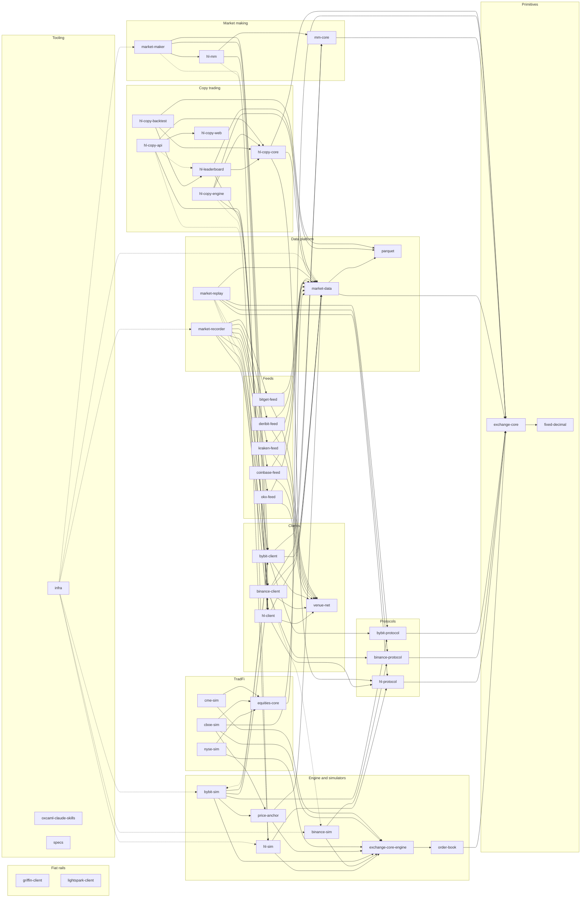

# Overview

The organization builds a crypto perpetuals trading stack in OxCaml on the Jane Street
libraries (Core, Async, ppx_jane): exchange simulators for Hyperliquid, Binance USD-M
Futures and Bybit v5 linear, typed clients for the same three venues, one venue-neutral
market-making strategy that runs on all of them, read-only market data feeds for five
more venues (OKX, Coinbase, Kraken, Deribit, Bitget), and a raw-first market data
platform that records live feeds and turns them into Parquet for SQL. A TradFi layer adds
simulators of NYSE, Cboe and CME that speak those venues' binary protocols over TCP, on
the same engine plus shared US equities and futures semantics. Every repository is an opam
package (or two), built with dune 3.17, tested with ppx_expect and Base_quickcheck, and
pinned from GitHub in CI. Locally all repositories sit side by side under one directory
with an untracked `dune-workspace`, so dune resolves siblings by public name.

## Repositories by layer

| Layer | Repository | Role | Status |
| --- | --- | --- | --- |
| Primitives | [fixed-decimal](repos/fixed-decimal.md) | 10^-8 fixed-point decimals, distinct types per use | done |
| Primitives | [exchange-core](repos/exchange-core.md) | Venue-neutral types (package `exchange-core`) and the exchange engine (package `exchange-core-engine`) | done |
| Protocols | [hl-protocol](repos/hl-protocol.md) | Hyperliquid wire types and JSON codecs | done |
| Protocols | [binance-protocol](repos/binance-protocol.md) | Binance USD-M wire types, codecs, HMAC signing | done |
| Protocols | [bybit-protocol](repos/bybit-protocol.md) | Bybit v5 linear wire types, codecs, signing | done |
| Engine and simulators | [order-book](repos/order-book.md) | Price-time priority book and matching | done |
| Engine and simulators | `exchange-core-engine` | Matching, clearinghouse, margin, funding, liquidation, noise traders (in [exchange-core](repos/exchange-core.md)) | done |
| Engine and simulators | [hl-sim](repos/hl-sim.md), [binance-sim](repos/binance-sim.md), [bybit-sim](repos/bybit-sim.md) | HTTP and websocket servers speaking each venue's API over the engine | done |
| Engine and simulators | [price-anchor](repos/price-anchor.md) | Anchors a simulated market to a live or recorded reference: mark, shadow levels, trade-replay fills | library done, simulator flags planned |
| TradFi | [equities-core](repos/equities-core.md) | US equities, options and futures semantics: sessions, ticks, lots, symbology, auctions, order types, halts, fees | done |
| TradFi | [nyse-sim](repos/nyse-sim.md), [cboe-sim](repos/cboe-sim.md), [cme-sim](repos/cme-sim.md) | NYSE Pillar and XDP, Cboe BOE and PITCH, CME iLink 3 and MDP 3.0 over the engine, binary over TCP | done |
| Clients | [venue-net](repos/venue-net.md) | Async HTTP and reconnecting websocket transport | done |
| Clients | [hl-client](repos/hl-client.md), [binance-client](repos/binance-client.md), [bybit-client](repos/bybit-client.md) | Typed venue clients, local books, `Live_feed` market data; Binance and Bybit also carry the `Mm_core.Venue.S` adapter | done |
| Feeds | [okx-feed](repos/okx-feed.md), [coinbase-feed](repos/coinbase-feed.md), [kraken-feed](repos/kraken-feed.md), [deribit-feed](repos/deribit-feed.md), [bitget-feed](repos/bitget-feed.md) | Read-only public market data as a `Market_data.Feed.t`, no trading | done |
| Market making | [mm-core](repos/mm-core.md) | Pure quoter, reconciler, risk, `Venue.S`, `Live.Make` loop | done |
| Market making | [hl-mm](repos/hl-mm.md) | Hyperliquid `Venue.S` adapter and `hl-mm` binary | done |
| Market making | [market-maker](repos/market-maker.md) | One `market-maker` binary for all three venues | done |
| Copy trading | [hl-copy-core](repos/hl-copy-core.md) | Pure mirroring, scaling, caps and leader scoring; `hl-copy-backtest` replays recorded leaders | done |
| Copy trading | [hl-leaderboard](repos/hl-leaderboard.md) | Leader collection, scoring and `/leaders` JSON | done |
| Copy trading | [hl-copy-engine](repos/hl-copy-engine.md) | Mirrors leaders into follower accounts with agent keys | done |
| Copy trading | [hl-copy-api](repos/hl-copy-api.md), [hl-copy-web](repos/hl-copy-web.md) | Wallet login, agent approval and follows; Bonsai frontend | in progress |
| Data platform | [parquet](repos/parquet.md) | Pure OCaml Parquet writer | done |
| Data platform | [market-data](repos/market-data.md) | Normalized types, event logs, Parquet sink, day close, DuckDB views, replay | done |
| Data platform | [market-recorder](repos/market-recorder.md) | Live recorder: raw minute files, event logs, uploader, metrics | done |
| Data platform | [market-replay](repos/market-replay.md) | Replay server: raw lines over HTTP, venue-native websockets for the eight crypto venues | done |
| Fiat rails | [griffin-client](repos/griffin-client.md) | Async client and CLI for a UK banking API: legal persons, accounts, payments, payees, Confirmation of Payee, webhooks; sandbox by default | done |
| Fiat rails | [lightspark-client](repos/lightspark-client.md) | Async client and CLI for a Lightning and UMA GraphQL API and a Grid banking API: nodes, invoices, customers, transfers, quotes; sandbox writes only, webhook verification | done |
| Tooling | [infra](repos/infra.md) | Container images, compose stack, Helm chart, deployment notes | done |
| Tooling | [oxcaml-claude-skills](repos/oxcaml-claude-skills.md) | Agent skills and the gotchas log | done |
| Tooling | specs | This repository | in progress |

## Dependency graph

Edges point from a package to the org packages it depends on, taken from each
`dune-project`. Edges implied by a longer path are left out for legibility (for example
`hl-sim` also lists `order-book` and `exchange-core` directly); each `repos/` page lists
the full set. Dotted edges are test-only dependencies (`:with-test`) or, for `infra`,
images it builds.

The copy-trading edges are planned from the design and are confirmed as each
repository's `dune-project` lands; hl-copy-engine's and hl-copy-api's are landed
(`hl-copy-web` stands for its `hl-copy-api-types` package, and the API reaches
`hl-leaderboard` over HTTP, linking it only in tests). `hl-copy-backtest` is the second
package of [hl-copy-core](repos/hl-copy-core.md); it needs `hl-leaderboard`, which needs
`hl-copy-core`. See [design/copytrading.md](design/copytrading.md).

The `*-feed` repositories also list `exchange-core` (Coinbase, Kraken, Deribit) and
`fixed-decimal` (Kraken) directly. `fixed-decimal`, `venue-net` and `parquet` depend on no
org package. `exchange-core`
holds two packages because `order-book` sits between them:
`fixed-decimal -> exchange-core -> order-book -> exchange-core-engine`.

## Runtime data flow

```mermaid
graph LR
  subgraph venues["Venues"]
    hl_api["Hyperliquid API"]
    bn_api["Binance USD-M API"]
    by_api["Bybit v5 API"]
    more_api["OKX, Coinbase, Kraken, Deribit, Bitget public APIs"]
  end
  subgraph sims["Simulators"]
    hl_sim["hl-sim :3000"]
    bn_sim["binance-sim :3300"]
    by_sim["bybit-sim :3400"]
  end
  subgraph tradfi_sims["TradFi simulators, binary over TCP"]
    nyse_sim["nyse-sim :4100-4102"]
    cboe_sim["cboe-sim :9300-9302"]
    cme_sim["cme-sim :4300-4302"]
  end
  tradfi_cli["*-sim-cli, e2e scripts, own SBE or BOE code"]
  tradfi_json["JSON feed on /ws"]
  live_feed["Live_feed in hl-, binance-, bybit-client"]
  feeds["Live_feed in the five *-feed repositories"]
  recorder["market-recorder"]
  raw["raw minute files .ndjson.zst"]
  norm["norm/ event logs .bin"]
  uploader["Uploader: rclone command"]
  s3[("S3 bucket")]
  day_close["market-data day-close"]
  pq["parquet/ tables"]
  duckdb["DuckDB SQL"]
  mm["market-maker"]
  anchor["price-anchor (planned)"]

  hl_api --> live_feed
  bn_api --> live_feed
  by_api --> live_feed
  sims --> live_feed
  live_feed -->|on_raw frames| recorder
  live_feed -->|Market_data.Event| recorder
  more_api --> feeds
  feeds -->|on_raw frames, Market_data.Event| recorder
  recorder --> raw
  recorder --> norm
  raw --> uploader
  uploader --> s3
  norm --> day_close
  day_close --> pq
  pq -->|rclone copy| s3
  pq --> duckdb
  s3 --> duckdb
  mm -->|orders, Venue.S| sims
  mm -.->|testnet or mainnet| venues
  venues -.-> anchor
  anchor -.->|mark, top-N levels, trades| sims
  tradfi_cli -->|Pillar, BOE, iLink 3 orders| tradfi_sims
  tradfi_sims -->|XDP, PITCH, MDP 3.0| tradfi_cli
  tradfi_sims --> tradfi_json
  anchor -.->|noise anchored to a reference| tradfi_sims
```

- Each client's `Live_feed.create ?on_raw config ~symbols ~streams` returns a
  `Market_data.Feed.t` (one pipe each for trades, BBO, L2 and funding) and passes every
  frame's text and receive time to `on_raw` before parsing.
- The `*-feed` repositories' `Live_feed.create` has the same shape, read-only, over each
  venue's public websocket.
- `market-recorder` writes raw frames to Tardis-style minute files and normalized events
  to `market-data` event logs, and hands closed minute files to a configurable upload
  command. See [design/data-platform.md](design/data-platform.md).
- `day-close` turns a finished day of event logs into Parquet tables and candles; in the
  Helm chart it runs as a CronJob next to the recorder and uploads `parquet/` with rclone.
  See [design/deployment.md](design/deployment.md).
- `market-maker` drives a simulator or a real venue through `Mm_core.Live.Make`. See
  [design/market-making.md](design/market-making.md).
- The copy-trading platform (in progress) mirrors a Hyperliquid leader's positions
  into followers' accounts through agent keys the followers approve, against `hl-sim`
  or testnet. See [design/copytrading.md](design/copytrading.md).
- The TradFi simulators have no real data source: noise traders move their books, and
  their order entry and market data are binary over TCP, with the feed repeated as JSON
  on `/ws`. Nothing in the data platform consumes them yet. See
  [design/simulators.md](design/simulators.md#tradfi-simulators).
- `price-anchor` is planned: anchoring simulator prices to real venues. See
  [design/price-anchor.md](design/price-anchor.md).

## Conventions shared by every OCaml repository

- `open! Core`, an `.mli` for every module, labelled arguments, ppx_jane derivations.
- Times are `int` nanoseconds or `Time_ns.t`; venue millisecond timestamps are converted
  at the edge.
- Prices, sizes and USD amounts are `Exchange_core.Price`, `Size`, `Usd`: distinct
  `Fixed_decimal.Make ()` types counting 10^-8 units in an `int`.
- Wire codecs live only in `*-protocol` repositories; `exchange-core` types carry no JSON.
- CI uses `ocaml/setup-ocaml@v3` with the `5.2.0+ox` compiler from the `ox` opam
  repository and pins sibling repositories from GitHub in dependency order.
