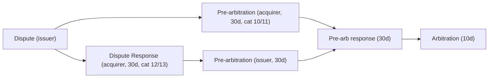

# Card issuing

Kind: reference.

## Summary

- Four parties: cardholder, issuer, acquirer, merchant; the scheme switches authorization and
  runs clearing and net settlement. The issuer (or its processor) decides each authorization.
- Authorization is a hold, not a debit. Clearing (first presentment) moves money and may differ
  from the authorized amount (tips, fuel, hotels, FX). A card ledger must allow N clearings,
  partial clearing, clearing above auth, and clearing with no matching auth.
- Visa approval validity: 5 days card present and merchant initiated, 10 days card absent,
  30 days for estimated auths at lodging, cruise and vehicle rental (Visa rules Table 5-12).
- Issuer response limit is 5 seconds in the Visa Europe region, 10 seconds elsewhere for POS;
  after that the scheme answers by Stand-In Processing and the issuer is liable for the result.
- EU interchange caps (Reg. (EU) 2015/751): 0.2% consumer debit (Art. 3), 0.3% consumer
  credit (Art. 4); commercial cards, ATM and three-party schemes are out of Chapter II.
- Disputes: Visa uses four categories (10 Fraud, 11 Authorization, 12 Processing Errors,
  13 Consumer Disputes); the fraud card-absent window is 120 days; each later stage is
  30 days, arbitration filing 10 days.
- 3-D Secure 2 returns a `transStatus` and ECI; ECI 05/02 (authenticated) shift fraud
  liability to the issuer. PSD2 exemptions (RTS 2018/389) are signalled through 3DS or the
  authorization.

## Authorization messages (ISO 8583)

| MTI | Meaning | Card-core effect |
| --- | --- | --- |
| 0100 / 0110 | Authorization request / response (dual message: clearing follows) | Create auth, place hold |
| 0120 / 0130 | Authorization advice / ack (decision already taken, e.g. by stand-in) | Record auth as decided; cannot decline |
| 0200 / 0210 | Financial request / response (single message: ATM, PIN debit) | Hold and clear in one step |
| 0400 / 0410 | Reversal request / response | Release hold (full or partial) |
| 0420 / 0430 | Reversal advice / ack | Release hold; must accept |

MTI list as published by an issuer-processor's data message protocol; ISO 8583 itself is
paywalled. The response code travels in field 39 (DE39).

| Code | Meaning (Visa Table 7-2 wording) | Visa category |
| --- | --- | --- |
| 00 | Approved (ISO 8583, unverified from primary) | n/a |
| 05 | Do not honor (ISO 8583, unverified); not listed by Visa | 4 generic |
| 14 | Invalid account number (no such number) | 1 never approve |
| 51 | Not sufficient funds | 2 cannot approve now |
| 54 | Expired card or expiration date missing | 3 data quality |
| 55 | PIN incorrect or missing | 3 data quality |
| 57 | Transaction not permitted to cardholder | 1 never approve |
| 61 | Exceeds approval amount limit | 2 cannot approve now |
| 65 | Exceeds withdrawal frequency limit | 2 cannot approve now |
| 91 | Issuer or switch inoperative | 2 cannot approve now |

Category 1 forbids the merchant to retry; categories 2 to 4 allow up to 20 attempts in
30 days. Visa adds `83` (Fraud/Security, Visa use only) from 25 July 2026 and `1A`
(additional customer authentication required) in the Europe region: the soft decline that
asks the merchant to rerun with SCA.

## Pre-authorization, incremental and partial

- Estimated authorization: merchant sends an estimate flagged with the Estimated
  Authorization indicator; it must not include damage amounts (Visa 5.7.2.4).
- Incremental authorization adds to an approved estimate under the same Transaction
  Identifier and does not extend the validity window (Visa 5.7.2.5, 5.7.3.5).
- Partial authorization: the issuer approves less than requested and the merchant collects
  the rest by other means; acquirer participation is mandatory for listed MCCs (Visa 7.3.9).
- Reversal: merchant must reverse the unused difference within 24 hours of completion, or the
  whole amount within 24 hours of cancellation or the end of validity (Visa Table 5-14).

## Hold expiry

| Case | Visa validity (Table 5-12) | Mastercard |
| --- | --- | --- |
| Card present, other | 5 days | 7 days final auth (secondary) |
| Card absent, cardholder initiated | 10 days (30 with extended auth indicator) | 7 days (secondary) |
| Merchant initiated (recurring, UCOF) | 5 days | 7 days (secondary) |
| Estimated auth: lodging, cruise, vehicle rental | 30 days | 30 days pre-auth (secondary) |
| Estimated auth: other rentals, campgrounds | 10 days | 30 days pre-auth (secondary) |

An acquirer-side processor publishes 7 days default and 31 days for lodging, cruise and
vehicle rental as its hold expiry; Mastercard numbers come from that page (unverified against
Mastercard rules). A merchant may still present after the issuer releases the hold.

## Clearing and settlement

- First presentment carries the final amount, which may differ from the auth: tips at
  restaurants, fuel pre-auth (Visa AFD completion within 2 hours), hotel extras, and the
  scheme rate when the merchant currency differs from the billing currency.
- One auth can clear several times (split shipments) or never (expiry); a clearing can arrive
  without an auth (offline, below floor limit, or stand-in advice already recorded).
- Refunds arrive as separate credit presentments, often weeks later, not as reversals.
- The scheme computes net positions per member per day and settles them through the
  settlement bank; the issuer pays clearing amount minus interchange. EU caps per transaction:
  0.2% debit, 0.3% credit (Reg. 2015/751 Arts. 3-4); Member States may set lower domestic caps.

## Disputes (Visa Core Rules, April 2026)

| Category | Example conditions | Dispute time limit |
| --- | --- | --- |
| 10 Fraud | 10.1 EMV counterfeit, 10.4 other fraud card-absent | 120 days from processing date (10.4) |
| 11 Authorization | 11.2 declined authorization, 11.3 no auth / late presentment | per condition |
| 12 Processing Errors | 12.5 incorrect amount, 12.6 duplicate / paid by other means | per condition |
| 13 Consumer Disputes | 13.1 not received, 13.6 credit not processed | per condition |

Categories 10 and 11 skip the Dispute Response step (allocation flow). Mastercard uses a
similar chargeback, second presentment, pre-arbitration, arbitration chain (unverified; the
public guide was not reachable).

## 3-D Secure 2

Flow: the 3DS Server sends AReq through the Directory Server to the issuer's ACS; ARes
returns `transStatus`. On `C` the browser or app exchanges CReq/CRes with the ACS, and the ACS
reports the final result in RReq (acknowledged by RRes). Message names and values below come
from processor docs restating the EMVCo spec (spec text not fetched).

| transStatus | Meaning | Visa ECI | Mastercard ECI |
| --- | --- | --- | --- |
| Y | Authenticated (frictionless or after challenge) | 05 | 02 |
| A | Attempted, not verified | 06 | 01 (secondary) |
| I | Informational only; issuer accepted exemption (2.2+) | 07 | 02 (secondary) |
| N | Not authenticated, deny | 07 (unverified) | 00 (unverified) |
| U | Could not be performed | 07 (unverified) | 00 (unverified) |
| R | Rejected by issuer, do not authorize | n/a | n/a |
| C | Challenge required (interim) | n/a | n/a |
| D | Decoupled challenge (interim, 2.2+) | n/a | n/a |

- Liability shift: with ECI 05/06 and a CAVV in the auth, fraud disputes under 10.4 move to
  the issuer; Visa allows ECI 5 or 6 in clearing only if the auth carried the CAVV
  (Visa 5.8.4.4). ECI 07 means no shift.
- PSD2 SCA (RTS 2018/389): Art. 11 contactless up to EUR 50 (cumulative 150 or 5 in a row);
  Art. 13 trusted beneficiaries; Art. 14 recurring same amount and payee after the first;
  Art. 16 remote up to EUR 30 (cumulative 100 or 5 in a row); Art. 18 transaction risk
  analysis at ETV EUR 100/250/500 for card fraud rates 0.13/0.06/0.01%.
- Exemptions are requested by the merchant in AReq (challenge indicator) or flagged directly
  in the authorization; an issuer that disagrees answers `1A` and the merchant reruns 3DS.

## Card controls and tokenization

- Typical controls: per transaction, daily, monthly, lifetime amount; per MCC allow or block
  (6011 ATM, 7995 gambling, 4829 money transfer, 6051 quasi-cash, 6540 stored value);
  ATM amount and count (decline `61`/`65`); country allow lists; e-commerce on or off.
- Network tokens (EMV Payment Tokenisation Framework v2.4, 2026): a Token Requestor (wallet,
  merchant, card-on-file service) asks the Token Service Provider for a token bound to a
  domain (device, merchant, channel); each use carries a cryptogram; the Payment Account
  Reference links tokens of one PAN. Device tokens (mobile wallets) get their own token number
  and lifecycle (suspend, resume, delete) independent of the card.

## Roles and PAN handling

| Role | Holds PAN | Decides auth | Notes |
| --- | --- | --- | --- |
| BIN sponsor (licensed issuer) | via processor | delegates | Scheme member; owns the BIN and liability |
| Issuer-processor | yes (PCI DSS) | runs rules; calls program for JIT | Sends auth webhook; stand-in on timeout |
| Program manager (us) | no | answers webhook | Sees card id, last 4, MCC, amounts |

- Real-time auth webhooks have tight budgets: one issuing platform gives 2 seconds, then
  approves or declines from configured defaults; the scheme itself waits 5 seconds (Europe).
- PAN display through the provider's hosted iframe keeps our servers out of PCI DSS scope.
  Masking shows at most the BIN and last 4 (first 6 or 8, last 4).
- BIN/IIN is 8 digits for BINs licensed from 22 April 2022 (Visa glossary). The last PAN digit
  is a Luhn (mod 10) check digit (ISO/IEC 7812-1, unverified from primary).

## What we adopt

1. `card-core` card states: `Inactive | Active | Frozen | Closed`. `Frozen` declines with
   `57`; `Closed` is terminal and declines with `14` (unknown) or `46` (closed account).
1. `card-core` auth record: `auth_id`, `card_id`, `network_txn_id` (links increments,
   reversals and clearings), `kind` (`Auth | Incremental | Advice | Financial`),
   `requested : Money.t` and `approved : Money.t` (billing currency), `merchant_amount` and
   `merchant_currency`, `merchant_name`, `mcc : int`, `merchant_country` (ISO 3166 alpha-2),
   `entry_mode` (`Chip | Contactless | Magstripe | Manual | Ecommerce | Token`), `eci : int option`,
   `three_ds : Y | A | I | N | U option`, `response_code : string` (two chars), `decided_by`
   (`Us | Stand_in | Provider_default`), `created_at`, `expires_at`.
1. `card-core` auth states: `Pending -> Authorized -> (Partially_cleared) -> Cleared`, plus
   `Declined`, `Reversed`, `Expired`. Reversals may be partial (reduce `approved`). Advice
   (0120) and stand-in auths enter `Authorized` directly and bypass our decision.
1. Clearing rules: allow N clearings per auth; each clearing settles `min(clearing, open hold)`
   from the hold and debits any excess as fresh spend (flag in `risk-rules` if excess > 20%,
   tips and hotels included; threshold is our choice); clearing with no auth posts directly;
   refunds are `Credit` presentments booked as new entries, never as reversals.
1. Hold expiry: `expires_at` = auth time + 7 days, or + 30 days when MCC is lodging (7011),
   vehicle rental (7512) or cruise (4411) or the auth is flagged estimated. On expiry release
   the remaining hold; a late clearing still posts.
1. `ledger`: auth places a hold `available -> pending_card` with idempotency key `auth_id`;
   increment adds, reversal or expiry releases, clearing moves `pending_card -> settled_card`
   and settles over the hold in one journal entry. Invariant: open hold per auth >= 0.
1. `risk-rules` card rules, evaluated in order, each returning `Block code` or `Allow`:
   card state, per-tx cap (`61`), daily and monthly caps (`61`), ATM count (`65`), MCC block
   list (`57`), country block (`57`), e-commerce off (`57`), funds (`51`), velocity (`Review`
   maps to decline `05`). Return a decision within 500 ms to leave margin under a 2 s webhook.
1. `banking-provider`: normalize provider card events to `Auth_request`, `Auth_advice`,
   `Reversal`, `Clearing`, `Refund`, `Expiry`; the fake provider simulates all six.

## Open questions

- Which events the provider exposes (advice, partial reversal, multi-clearing, expiry).
- Does the provider apply its own hold expiry or forward ours?

## Sources

- Visa Core Rules and Visa Product and Service Rules, 18 April 2026:
  <https://usa.visa.com/dam/VCOM/download/about-visa/visa-rules-public.pdf>
- Dispute Management Guidelines for Visa Merchants, June 2024:
  <https://usa.visa.com/dam/VCOM/global/support-legal/documents/merchants-dispute-management-guidelines.pdf>
- Regulation (EU) 2015/751, Arts. 1, 3, 4:
  <https://www.legislation.gov.uk/eur/2015/751/contents/adopted>
- Commission Delegated Regulation (EU) 2018/389, Arts. 11-18 and Annex:
  <https://www.legislation.gov.uk/eur/2018/389/contents/adopted>
- EMVCo 3-D Secure: <https://www.emvco.com/emv-technologies/3-d-secure/>
- EMVCo Payment Tokenisation: <https://www.emvco.com/emv-technologies/payment-tokenisation/>
- 3DS API reference (transStatus, ECI, reason codes):
  <https://docs.adyen.com/online-payments/3d-secure/api-reference>
- Authorisation hold expiry by scheme:
  <https://docs.adyen.com/issuing/payment-stages/authorisation-holds.md>
- Real-time authorization webhook (2 s timeout):
  <https://docs.stripe.com/issuing/controls/real-time-authorizations>
- Issuer-processor message protocol (MTIs, DE39):
  <https://developer.paymentology.com/docs/data-message-protocol>
- PCI SSC, 8-digit BINs and PCI DSS:
  <https://blog.pcisecuritystandards.org/8-digit-bins-and-pci-dss-what-you-need-to-know>
