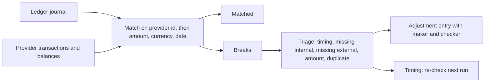

# Core ledger design

Kind: reference.

## Summary

- A ledger is an append-only log of balanced entries; balances, statements and reports
  are folds over it. Corrections are new entries (reversal or adjustment), never edits.
- Two-phase transfers (reserve, then post or void, with an optional timeout) are the
  standard way to hold funds for card authorizations and in-flight payouts. A partial post
  releases the remainder; a pending transfer resolves at most once.
- Atomicity across several entries (an FX swap's two currency legs plus a fee) comes from
  linked events: all succeed or none do.
- Idempotency is end to end: the id is chosen by the client before the first attempt and
  reused on every retry; a retry with the same id and the same fields is "exists", with
  different fields is an error, and a retry never changes the outcome of the first attempt.
- Amounts are integers in the smallest unit of a fixed asset scale per currency; the
  scale cannot change after the first booking without a new ledger.
- Clearing and suspense accounts must return to zero when a flow completes; a non-zero,
  ageing balance is how a missing or wrong event is found. Reconciliation against the
  provider's statements is a daily job that produces breaks, not silent overwrites.
- End of day is a business-date concept: a close fixes a closing balance per account and
  forbids new bookings dated inside the closed period.

## Reference model: TigerBeetle

TigerBeetle is a purpose-built financial database whose data model is the clearest public
statement of ledger invariants. Its records are fixed-size and immutable.

| Account field | Meaning |
| --- | --- |
| `id` (u128) | Client-chosen, unique cluster-wide; not 0 or 2^128-1 |
| `debits_pending`, `credits_pending` | Amounts reserved by open pending transfers |
| `debits_posted`, `credits_posted` | Cumulative posted totals; balance is derived from them |
| `ledger` (u32) | Partition, typically one per currency; only same-ledger accounts transact |
| `code` (u16) | Account type ("why"), e.g. customer liability, settlement asset |
| `user_data_128/64/32` | Indexed application data: owner, real-world time, jurisdiction |
| `flags` | `debits_must_not_exceed_credits`, `credits_must_not_exceed_debits`, `history`, `closed`, `linked`, `imported` |
| `timestamp` | Assigned by the cluster at commit (ns), unique across all objects |

| Transfer field | Meaning |
| --- | --- |
| `id` | Client-chosen idempotency id |
| `debit_account_id`, `credit_account_id` | Exactly one of each, different, same ledger |
| `amount` (u128) | Non-zero, except on post (`AMOUNT_MAX` = full) and void |
| `pending_id` | On post or void, the pending transfer it resolves |
| `timeout` (u32 s) | Only on pending; an interval from the commit timestamp, robust to clock skew |
| `ledger`, `code` | Must match the accounts; `code` is the reason for the movement |
| `flags` | `linked`, `pending`, `post_pending_transfer`, `void_pending_transfer`, `balancing_debit`, `balancing_credit`, `closing_debit`, `closing_credit`, `imported` |

Invariants it guarantees:

- Sum of all `debits_posted` equals sum of all `credits_posted`; the same for pending.
- A non-negative customer balance is a flag on the account
  (`debits_must_not_exceed_credits` for a credit-normal liability), checked against
  `pending + posted + amount`, so a reservation cannot be overdrawn by a later post.
- A pending transfer is posted, voided or expires exactly once; further attempts return
  `pending_transfer_already_posted`, `_already_voided` or `_expired`. Posting more than
  the pending amount is `exceeds_pending_transfer_amount`; a partial post restores the
  remainder to the original accounts.
- Resolution never mutates the pending record; it is a new transfer pointing at it.
- Expired transfers can no longer be posted or voided; the pending balance is removed at
  expiry (best effort, in expiry order).
- `linked` chains succeed or fail together; an unterminated chain is
  `linked_event_chain_open`, and a failure in the chain marks the others
  `linked_event_failed`.

Idempotency results, in precedence order: `exists_with_different_<field>` (same id,
conflicting field) before `exists` (same id, same fields) before validation errors. A
failure that depends on state at a point in time (`exceeds_credits`,
`debit_account_not_found`, `debit_account_already_closed`, ...) is recorded against the
id, and a retry returns `id_already_failed` even if the state has since changed: "retrying
a transfer will not produce a different outcome (either success or failure)". A caller
that wants to try again after such a failure uses a new id.

The recommended id is 128 bits: 48 bits of millisecond time and 80 random bits,
incremented within a millisecond, generated by the client (not the API) and persisted
before the request is sent, so a restarted client resubmits the same id.

## Multi-currency

A transfer is single-ledger, so a currency exchange is two transfers through a liquidity
(conversion) account in each currency, linked so both or neither book:

```text
T1  ledger EUR  debit customer:EUR      credit fx_liquidity:EUR   100.00   linked
T2  ledger BTC  debit fx_liquidity:BTC  credit customer:BTC       0.00163  (ends chain)
```

The rate is implied by the two amounts; rounding goes in the liquidity account's favour.
A fee is its own linked transfer at the start of the chain rather than folded into the
rate, so rate and fee stay separately auditable. Asset scale is fixed per currency ("think
about whether your application may ever require a larger asset scale"); changing it means
a new ledger and a migration.

## Event-sourced ledgers in production

A large payments platform's published ledger design follows the same shape: an immutable
event log from which "any state can be rebuilt by replaying events up to a given point";
producer systems modelled as accounts connected by events; clearing accounts that must
net to zero once a flow completes, so "find clearing accounts with a non-zero balance" is
the detector for missing, late or wrong events; and a data-quality score built from three
questions per slice of data: clearing (did the flow complete), timeliness (did data
arrive within a threshold of its producer timestamp) and completeness (does every
producer id have a ledger event). Fixes are reversals and reprocessing, reviewed like
code, with a report of their effect.

Core banking products add a business date distinct from system time: close of business
(COB) runs per business date, and an accounting closure forbids postings dated before the
closure date; back-dating past a closure requires reopening it, an audited act.

## Balance snapshots and end of day

- Keep cumulative debit and credit totals per account (not a single signed balance), so
  any balance convention and the trial balance are cheap and overflow is visible.
- Pending and posted are separate columns; `available = posted - pending` on the
  account's normal side.
- At COB for business date D: append a `Close { business_date = D }` record, then emit a
  snapshot per (account, currency): opening balance, total debits, total credits, closing
  booked balance, closing available balance. These map onto the ISO 20022 balance types
  used in camt.053 statements: `OPBD` opening booked, `CLBD` closing booked, `CLAV`
  closing available, `ITBD` interim booked.
- Snapshots are derived data with the journal sequence number they cover; replay starts
  from the latest snapshot and re-folds the tail, and a full replay must reproduce every
  snapshot exactly (a cheap integrity check).
- After a close, an entry whose `business_date` is inside the closed period is refused;
  late-arriving events are booked on the current business date with their original
  `effective_at` (value date) kept as data.

## Reconciliation and breaks

Three sources must agree each business day: our journal, the provider's view (balances,
transaction lists, webhooks) and, for a real bank, the safeguarding or nostro statement
(camt.053).



| Break type | Typical cause | Resolution |
| --- | --- | --- |
| Timing | Webhook not yet received, cut-off differences | Auto-clears on a later run; alert if it ages past N days |
| Missing internal | Lost webhook, crash between provider call and booking | Book from the provider record (it is the evidence) |
| Missing external | We booked, provider has nothing (failed call treated as success) | Reverse our entry |
| Amount or currency mismatch | Fees, FX rounding, partial capture | Adjustment entry to a fee or rounding account |
| Duplicate | Same provider id booked twice under different keys | Reverse the duplicate; fix the key derivation |

Breaks are records with an id, type, both sides' references, amount, first-seen business
date and status (`Open`, `Explained`, `Resolved`); ageing buckets (0-1, 2-5, over 5 business
days) are the operational metric. A balance difference is never fixed by overwriting
state: it is an explicit adjustment entry, approved by a second person.

## What we adopt

For `ledger` (most already present; new items marked):

1. Keep: single-currency balanced entries, Liability customer accounts, `allow_negative`
   only on settlement and external accounts, holds on a pending sub-account, reversals
   linked by sequence, idempotency keys booked once with `Duplicate { seq }` on retry and
   an error on reuse with different content.
1. New: linked groups. `Journal.transfer_group` appends several entries atomically (one
   record, or consecutive records with a `group` id and a terminating flag), so an FX swap
   (two currency legs plus a fee entry) and a card settlement with a fee never half-book.
1. New: hold expiry. `Journal.hold ~timeout` stores `expires_at = recorded_at + timeout`;
   an `Expire` record (written by a sweeper, or at COB) releases it; capture or release of
   an expired hold is refused with `Hold_expired`. Partial capture releases the remainder
   in the same record (already the behaviour to confirm in a test).
1. New: a capture above the hold amount is allowed only with an explicit `~over_capture`
   reason (card settlement above authorization, see [cards](cards.md)) and books the
   excess as a separate posting.
1. New: a stable `Entry.code` (an enum: `Deposit`, `Withdrawal`, `Transfer_intraledger`,
   `Fx_leg`, `Fee`, `Card_auth`, `Card_settlement`, `Refund`, `Reversal`, `Adjustment`,
   `Interest`, `Safeguarding_sweep`) next to the free `tag`, so reports group by reason.
1. New: failed attempts are remembered. When an entry with a key is refused for a
   state-dependent reason (insufficient funds, account closed), record the key as failed
   so a retry returns the same refusal; callers who want a new attempt take a new key.
   The ledger stays the place that answers "what happened to request X".
1. New: account status `Open | Frozen | Closed` as records in the journal. Frozen refuses
   debits except hold releases; Closed refuses everything but releases and requires a
   zero balance.
1. New: business date and close. Every entry carries `business_date` (from the journal's
   time source, not the wall clock); `Journal.close_day` appends a `Close` record and
   writes a snapshot file of per-account opening, debits, credits, closing booked and
   closing available, with the covered sequence number. Entries dated in a closed period
   are refused. Replay may start at the latest snapshot and must reproduce it.
1. New: `Reconciliation` (in `ledger` or `payments-core`, see implications): break
   records with the types above, ageing buckets, and resolution only through an
   `Adjustment` entry that carries `maker` and `checker` operator ids, which must differ.
1. Keep asset scale fixed per currency in `money` (EUR 2, BTC 8, ETH 18, USDC 6, USDT 6);
   a change is a new currency code, never a rescale of existing entries.
1. Clearing accounts per flow (`clearing:sepa_out`, `clearing:card`, `clearing:fx`)
   whose balances must return to zero; a report lists non-zero clearing balances older
   than one business day.

For callers (`payments-core`, `card-core`, `neobank-api`): derive the idempotency key
from the client request id (generated by the web client and persisted before the first
attempt) or from the provider's event id and state, never from a server timestamp.

## Open questions

- Should a failed key be remembered forever or for a retention window (24 hours is common
  for public payment APIs)? Forever is simplest in a journal; size is small.
- Hash-chaining journal records for tamper evidence: see
  [reliability and security](reliability-and-security.md).

## Sources

- TigerBeetle transfers reference: <https://docs.tigerbeetle.com/reference/transfer/>
- TigerBeetle accounts reference: <https://docs.tigerbeetle.com/reference/account/>
- TigerBeetle two-phase transfers: <https://docs.tigerbeetle.com/coding/two-phase-transfers/>
- TigerBeetle `create_transfers` results and idempotency:
  <https://docs.tigerbeetle.com/reference/requests/create_transfers/>
- TigerBeetle reliable transaction submission:
  <https://docs.tigerbeetle.com/coding/reliable-transaction-submission/>
- TigerBeetle data modeling (ledgers, asset scale, ids):
  <https://docs.tigerbeetle.com/coding/data-modeling/>
- TigerBeetle currency exchange recipe:
  <https://docs.tigerbeetle.com/coding/recipes/currency-exchange/>
- "Ledger: a system for tracking and validating money movement" (payments platform
  engineering blog):
  <https://stripe.dev/blog/ledger-stripe-system-for-tracking-and-validating-money-movement>
- Accounting closures in a core banking product: <https://docs.mambu.com/docs/accounting-closures/>
- Business date and close of business in an open-source core banking system (conference
  slides): <https://communityovercode.apache.org/slides/na-2023/tues_fintech_adamsaghy_cob-adam-saghy.pdf>
- ISO 20022 external code sets (balance type codes): <https://www.iso20022.org/catalogue-messages/additional-content-messages/external-code-sets>
