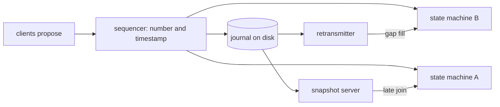

# State machines and logs

This theme covers the architecture behind Jane Street's Concord and Aria: deterministic state
machines fed by one sequenced log, delivered over multicast with gap fill, rebuilt by replay
and shortened by snapshots. It matters to us because the same shape already exists in pieces
across our repos. The simulators wrap a deterministic engine, the recorder writes append-only
event logs, `Replay_feed` merges them back in order, and the planned two-region replication is
a gap-fill problem. What we lack are the disciplines that make those pieces trustworthy:
journals of inputs, sequence numbers, visible gaps, snapshots for late joiners, versioned log
formats and tools that let a person step through a recorded day.

## Deterministic state machines are reproducible by construction

The core abstraction in
[episode 14](../janestreet/podcast/14-state-machine-replication-and-why-you-should-care.md) is a
module that holds state, consumes one message at a time synchronously, and never blocks on disk
or network. Given the same messages it always reaches the same state, so a restarted process
replays the day's log and becomes an exact copy of itself, and a second process can embed the
same machine instead of asking the first one over the network. The
[exchange talk announcement](../janestreet/blog/2017-01-how-to-build-an-exchange.md) frames
this as the reason high-throughput, low-jitter components matter: they make a simple
replication scheme possible at all.

Determinism is also what makes testing pay off.
[Episode 26](../janestreet/podcast/26-why-testing-is-hard-and-how-to-fix-it.md) describes a
database built inside a seeded, single-process simulation where every source of
non-determinism (clock, network, disk, scheduling) is injected, so a failing run replays
exactly. Aria's own toolbox in
[battle-tested](../janestreet/blog/2025-12-getting-from-tested-to-battle-tested.md) relies on
a simulated network with controlled time, and the Hardcaml effects post
([algebraic effects](../janestreet/blog/2026-01-fun-with-algebraic-effects-hardcaml.md))
shows a stepped harness that drives a design cycle by cycle. The lesson for us: a
deterministic component is only half the value; the other half is a recorded input journal
and a test that replays it and compares outputs.

## One sequencer, one total order

An exchange's matching engine is essentially a sequencer: it funnels requests into one place,
assigns a total order and publishes it, and everything downstream (executions, reports, public
data) is a function of that order
([episode 3](../janestreet/podcast/03-multicast-and-the-markets.md)). Concord does the same
with an explicit sequencer that stamps proposals with a sequence number and timestamp and
rebroadcasts them; failover to a backup is deliberately manual, and a single choke point
turns out to scale to hundreds of thousands of messages per second
([episode 14](../janestreet/podcast/14-state-machine-replication-and-why-you-should-care.md)).
The [data warehouse episode](../janestreet/podcast/28-building-a-data-warehouse-from-scratch.md)
accepts the same single point of failure for metadata.

Aria keeps one total order across all topics, unlike per-partition systems where a replay lets
small topics run ahead of large ones. When it later indexed the in-memory tip per topic
partition, rebuilding the ordered stream became an n-way min-heap merge, and the heap was the
bottleneck worth optimizing
([message bus indexing](../janestreet/blog/2026-10-scaling-and-benchmarking-a-critical-message-bus.md)).
Our `Merge` and `Replay_feed` are exactly that n-way merge over per-stream files. Total order
across machines also has a limit: two hosts' timestamps are only comparable within their clock
error bounds, and stepped clocks break code that assumes time only moves forward
([episode 6](../janestreet/podcast/06-clock-synchronization.md)). A merge by earliest `recv_ts`
must treat near-ties as unordered and must not trust a clock that jumps backwards.

## Gaps must be detected, filled and made visible

Multicast is neither reliable nor ordered, so every message carries a sequence number,
receivers notice a hole and ask a retransmitter, and retransmitters ask each other before the
sequencer. General reliable multicast was rejected because one slow receiver would throttle
the publisher; stragglers recover on their own
([episode 3](../janestreet/podcast/03-multicast-and-the-markets.md),
[episode 14](../janestreet/podcast/14-state-machine-replication-and-why-you-should-care.md)).
Most drops come from slow consumers, not the network. The venue websockets we consume follow
the same idea in miniature: Binance and Bybit update ids let a client local book detect a gap
and resync from a snapshot.

The failure mode the sources keep returning to is a gap or bad input that vanishes silently.
Unexpected input that crashes an error path or is dropped without a count is the classic
pipeline incident in [episode 20](../janestreet/podcast/20-solving-puzzles-in-production.md).
A zero-byte message served after a retransmitter restarted from a snapshot was the bug
Antithesis found in Aria
([battle-tested](../janestreet/blog/2025-12-getting-from-tested-to-battle-tested.md)): a
request older than the snapshot should have been an explicit error. Re-broadcasting full state
on every small change makes bursts quadratic and lets a consumer lag without anyone noticing
([systemd and SystemTap](../janestreet/blog/2020-02-troubleshooting-systemd-with-systemtap.md)),
and many feeds that reconnect in lockstep after a partition create their own storm
([network maintenance bugs](../janestreet/blog/2026-10-how-recurring-network-maintenance-exposed-6-bugs.md)).
For a recorder this means: a reconnect, resync or parse error must leave a mark in the data
and a count in metrics, and a reader asking for data that is not there gets an error.

## Snapshots are consumer specific and bound the cost of joining late

Replaying from the start of the day stops scaling as logs grow. Concord had no snapshots, so a
late starter replayed the whole day; Aria's initial recovery once took minutes instead of
seconds because it read ten times more data than needed
([message bus indexing](../janestreet/blog/2026-10-scaling-and-benchmarking-a-critical-message-bus.md)).
The guest in [episode 3](../janestreet/podcast/03-multicast-and-the-markets.md) points out that
domain knowledge lets a late joiner load a compact book snapshot instead, and
[episode 14](../janestreet/podcast/14-state-machine-replication-and-why-you-should-care.md)
adds the catch: a snapshot is specific to what a consumer computes. An open-orders snapshot
cannot rebuild a count of the day's orders, so Aria plans client-built snapshot servers that
reuse other teams' state machine libraries.

Snapshots also enable time travel. The Limshare debugger in
[the 2024 intern projects](../janestreet/blog/2024-08-what-the-interns-have-wrought-2024-edition.md)
could only step forward from the start of day until an intern added periodic snapshots; then
stepping backwards became restore-and-replay, with breakpoints on events such as a rejected
request. For market data the natural snapshot is the L2 book, and the natural debugger is a
book at time t.

## Inversion of control and small composable machines

Concord apps are written in an inverted style: the framework asks the app what it wants to
sequence next, rather than the app pushing messages from threads. That moves hidden state off
stacks into explicit data, and a test can feed messages in any order to reproduce a race. The
typical bug in this style is an injector that forgets to record that its proposal was
sequenced and so re-proposes forever
([episode 14](../janestreet/podcast/14-state-machine-replication-and-why-you-should-care.md)).
The UI framework in [episode 11](../janestreet/podcast/11-building-a-ui-framework.md) reaches
the same place from another direction: model, action and transition as an explicit machine, with
more than half of the guest's components being state machines with no view at all.

Our `Mm_core.Strategy` already has this shape (`on_book`, `on_fill`, `tick` returning actions)
and `Reconciler` computes a plan from resting orders, which is the inverted, idempotent style.
What we do not have is the log of inputs that would let a session be replayed through it, or a
machine-readable reason for each decision so two runs or two parameter sets can be diffed
([Windows config orchestrator](../janestreet/blog/2026-10-config-management-orchestrator-for-windows.md)).
A runaway injector with no rate limit hurts everyone downstream, which argues for a cap on our
own action rate.

## The log format is a versioned contract

Because every process reads one broadcast, there is no room for version negotiation: Concord
writes a digest of the message type in the first message, and an app that does not recognize
it refuses to start. Message-only changes roll separately from logic changes, and code that
interprets messages is itself an implicit version, since a new binary can reach a different
state from the same log
([episode 14](../janestreet/podcast/14-state-machine-replication-and-why-you-should-care.md)).
Aria adds version-skew tests between old and new clients and servers
([battle-tested](../janestreet/blog/2025-12-getting-from-tested-to-battle-tested.md)), and a
fixed-width serializer built for hot transaction logging was made safe by round-trip property
tests ([2024 intern projects](../janestreet/blog/2024-08-what-the-interns-have-wrought-2024-edition.md)).
Our `Market_data` records pin their `Stable.V1` bin shapes in tests, but the files themselves
carry no shape digest, so an old reader would decode a new file as garbage.

## Logs as instruments for people

Several sources treat the log as the main debugging tool rather than an archive. Order-to-fill
latency could only be measured once the trading system's own order events were recorded next to
market data ([2023 intern projects](../janestreet/blog/2023-09-what-the-interns-have-wrought-2023.md)).
Per-second socket history from a host collector reconstructed an incident weeks later
([network maintenance bugs](../janestreet/blog/2026-10-how-recurring-network-maintenance-exposed-6-bugs.md)),
and diagnostics must not share a dependency with the failure they report
([kernel reporter](../janestreet/blog/2026-10-linux-engineering-kernel-reporter.md)). Repeated
warnings need stateful damping to stay readable
([episode 23](../janestreet/podcast/23-building-tools-for-traders.md)).

## Where we stand

- [exchange-core](../../repos/exchange-core.md): the engine is a deterministic state machine
  (caller-advanced nanosecond clock, sequential ids, seeded `Market_sim`), matching the
  sequencer of episode 3. Its only determinism test, "same seed, same run", compares final mids
  after 50 ticks, not the full event stream. `Event.t` has a `time` but no sequence number, and
  there is no input journal or replay test.
- [hl-sim](../../repos/hl-sim.md), [binance-sim](../../repos/binance-sim.md) and
  [bybit-sim](../../repos/bybit-sim.md) inherit the engine's determinism, but do not log
  accepted requests, so a simulator session cannot be replayed.
- [market-data](../../repos/market-data.md): `Event_log` is an append-only per-stream daily log
  and `Replay_feed.of_files` merges files by `recv_ts` through the k-way `Merge`. Files have no
  header or shape digest; `Feed.S` exposes only trades, BBO, L2 and funding pipes, with no gap
  or reconnect event; `Replay_feed` always starts at the beginning of its inputs; the binary
  has `day-close`, `views` and `query` but no dump or book-at-time tool.
- [market-recorder](../../repos/market-recorder.md): its own known gaps state that parse
  errors and reconnects inside the clients are neither counted nor marked (a disconnect line is
  written only on stop), and that there is one collector per venue. There is no `recv_ts`
  clamping.
- [mm-core](../../repos/mm-core.md): `Strategy` is an explicit input-to-actions machine and
  `Reconciler` plans from resting orders, but no property pins that reconciling twice is a
  no-op, and `Risk` has no action-rate cap.
- [market-maker](../../repos/market-maker.md): runs are not bit-repeatable with a fixed seed
  because request timing changes matching order, and strategy inputs and order lifecycle events
  are not logged for replay or SQL.
- [design/cloud-sinks-and-replication.md](../../design/cloud-sinks-and-replication.md): the
  planned merge keeps the earliest `recv_ts` copy and fills stretches one collector missed, but
  leaves message identity per venue, reconnect marking and clock-error ties as open questions.

## Proposed actions

1. Add an input journal to the engine recording every `place`, `cancel`, `modify`, `step` and
   `set_mark`, plus an expect test that replays it into a fresh engine and diffs
   `drain_events`; extend "same seed, same run" to compare full event streams as sexps, in
   [exchange-core](../../repos/exchange-core.md)
   ([episode 14](../janestreet/podcast/14-state-machine-replication-and-why-you-should-care.md),
   [exchange talk](../janestreet/blog/2017-01-how-to-build-an-exchange.md)).
2. Add a gap or reconnect event to `Market_data.Feed.t`, emitted by each client's `Live_feed` on
   resync and written as a disconnect line, with an expect test forcing a Bybit sequence gap;
   document frame loss on reconnect in the `Ws_client` doc comment, in
   [market-data](../../repos/market-data.md), [market-recorder](../../repos/market-recorder.md),
   the three clients and [venue-net](../../repos/venue-net.md)
   ([episode 3](../janestreet/podcast/03-multicast-and-the-markets.md),
   [writing technically](../janestreet/podcast/10-writing-technically.md)).
3. Count per-stream parse errors from each `Live_feed` in recorder `/metrics`, tested with one
   malformed frame from the simulator, in [market-recorder](../../repos/market-recorder.md),
   [hl-client](../../repos/hl-client.md), [binance-client](../../repos/binance-client.md),
   [bybit-client](../../repos/bybit-client.md) and [hl-sim](../../repos/hl-sim.md)
   ([episode 20](../janestreet/podcast/20-solving-puzzles-in-production.md)).
4. Write a periodic (per-minute) L2 snapshot event into the event log, and let `Replay_feed`
   start at the last snapshot at or before the requested start, in
   [market-recorder](../../repos/market-recorder.md) and
   [market-data](../../repos/market-data.md)
   ([episode 3](../janestreet/podcast/03-multicast-and-the-markets.md),
   [episode 14](../janestreet/podcast/14-state-machine-replication-and-why-you-should-care.md)).
5. In the replication design, specify gap detection by venue sequence fields (Binance `pu`/`u`,
   Bybit `seq`) with gap fill from the peer collector, state that frames whose `recv_ts` differ
   by less than the clock error bound are unordered, and add a failure table (collector down,
   region down, uploader stalled) with expected gaps and detection, in
   [design/cloud-sinks-and-replication.md](../../design/cloud-sinks-and-replication.md)
   ([episode 14](../janestreet/podcast/14-state-machine-replication-and-why-you-should-care.md),
   [episode 6](../janestreet/podcast/06-clock-synchronization.md),
   [episode 27](../janestreet/podcast/27-the-network-as-a-program.md)).
6. Write a header frame carrying the `bin_shape` digest of `Event.Stable.V1` at the start of
   each `Event_log` file and fail readers on a mismatch; check in a log written by current code
   and test that later versions still read it, in [market-data](../../repos/market-data.md)
   ([episode 14](../janestreet/podcast/14-state-machine-replication-and-why-you-should-care.md),
   [battle-tested](../janestreet/blog/2025-12-getting-from-tested-to-battle-tested.md)).
7. Add a sequence number to the engine's `Event` and an expect test that replays drained events
   into a fresh book and compares the L2 snapshot, in
   [exchange-core](../../repos/exchange-core.md)
   ([episode 3](../janestreet/podcast/03-multicast-and-the-markets.md)).
8. Add an option to `hl-sim` that appends every accepted `/exchange` request with its timestamp
   to a file, and a test replaying it into a fresh engine with identical fills, in
   [hl-sim](../../repos/hl-sim.md)
   ([2024 intern projects](../janestreet/blog/2024-08-what-the-interns-have-wrought-2024-edition.md)).
9. Pin global replay order: an expect test replaying a 10-event and a 10,000-event stream
   together with sorted `recv_ts` output, and a Base_quickcheck property writing random
   multi-symbol events through `Event_log` and `Merge` checking order with no loss or
   duplicates, in [market-data](../../repos/market-data.md)
   ([episode 14](../janestreet/podcast/14-state-machine-replication-and-why-you-should-care.md),
   [message bus indexing](../janestreet/blog/2026-10-scaling-and-benchmarking-a-critical-message-bus.md)).
10. Add a debug option in `market-maker` that logs each `Strategy` input and the resulting
    plan as one sexp line, with a test replaying a log through `Strategy`; also record order
    lifecycle events to an event log queryable with SQL, in
    [market-maker](../../repos/market-maker.md), [mm-core](../../repos/mm-core.md) and
    [market-data](../../repos/market-data.md)
    ([episode 11](../janestreet/podcast/11-building-a-ui-framework.md),
    [2023 intern projects](../janestreet/blog/2023-09-what-the-interns-have-wrought-2023.md)).
11. Drive `Strategy` against the engine through a deterministic stepped harness on a synthetic
    `Time_source`, pin one fixed-seed run's fills, and print the seed on failure, in
    [mm-core](../../repos/mm-core.md) and [exchange-core](../../repos/exchange-core.md)
    ([algebraic effects](../janestreet/blog/2026-01-fun-with-algebraic-effects-hardcaml.md),
    [episode 26](../janestreet/podcast/26-why-testing-is-hard-and-how-to-fix-it.md)).
12. Clamp `recv_ts` to be non-decreasing per stream and count clamped frames in `/metrics`, in
    [market-recorder](../../repos/market-recorder.md)
    ([episode 6](../janestreet/podcast/06-clock-synchronization.md)).
13. Add a `market-data dump` subcommand printing one stream's `Event_log` records between
    `-from` and `-to` as sexps, then a `-book-at` option replaying L2 into a local book and
    printing the top levels, in [market-data](../../repos/market-data.md)
    ([2024 intern projects](../janestreet/blog/2024-08-what-the-interns-have-wrought-2024-edition.md)).
14. Make `Replay_feed` return an explicit error for a date range with no event log files, with
    an expect test, in [market-data](../../repos/market-data.md)
    ([battle-tested](../janestreet/blog/2025-12-getting-from-tested-to-battle-tested.md)).
15. Add a Base_quickcheck property that applying a reconcile plan and reconciling again yields
    only `Keep` actions, in [mm-core](../../repos/mm-core.md)
    ([episode 14](../janestreet/podcast/14-state-machine-replication-and-why-you-should-care.md)).
16. Add an actions-per-second cap to `Mm_core.Risk` that trips the kill switch when the live
    loop exceeds it, in [mm-core](../../repos/mm-core.md)
    ([episode 14](../janestreet/podcast/14-state-machine-replication-and-why-you-should-care.md)).
17. Have the quoter return a typed reason for each unquoted side, logged as a sexp, so runs from
    two implementations or parameter sets can be diffed, in [mm-core](../../repos/mm-core.md)
    ([Windows config orchestrator](../janestreet/blog/2026-10-config-management-orchestrator-for-windows.md)).
18. Add an expect test counting subscribe frames sent at connect and reconnect for a three-symbol
    config, to catch full-state re-broadcasts, in
    [market-recorder](../../repos/market-recorder.md)
    ([systemd and SystemTap](../janestreet/blog/2020-02-troubleshooting-systemd-with-systemtap.md)).
19. Add a SQL view of per venue, symbol and day minutes with zero trades or BBO updates, tested
    on a fixture with a gap, in [market-data](../../repos/market-data.md)
    ([episode 22](../janestreet/podcast/22-finding-signal-in-the-noise.md)).
20. Report the last `Raw_writer` flush error and its age in the recorder's `/healthz`, in
    [market-recorder](../../repos/market-recorder.md)
    ([kernel reporter](../janestreet/blog/2026-10-linux-engineering-kernel-reporter.md)).
21. Log repeated warnings of one kind (parse errors, upload retries) at most once a minute per
    stream with a suppressed count, in [market-recorder](../../repos/market-recorder.md)
    ([episode 23](../janestreet/podcast/23-building-tools-for-traders.md)).
22. Add a node-exporter or equivalent socket and file-descriptor collector to the compose stack
    and Helm notes, in [infra](../../repos/infra.md)
    ([network maintenance bugs](../janestreet/blog/2026-10-how-recurring-network-maintenance-exposed-6-bugs.md)).
